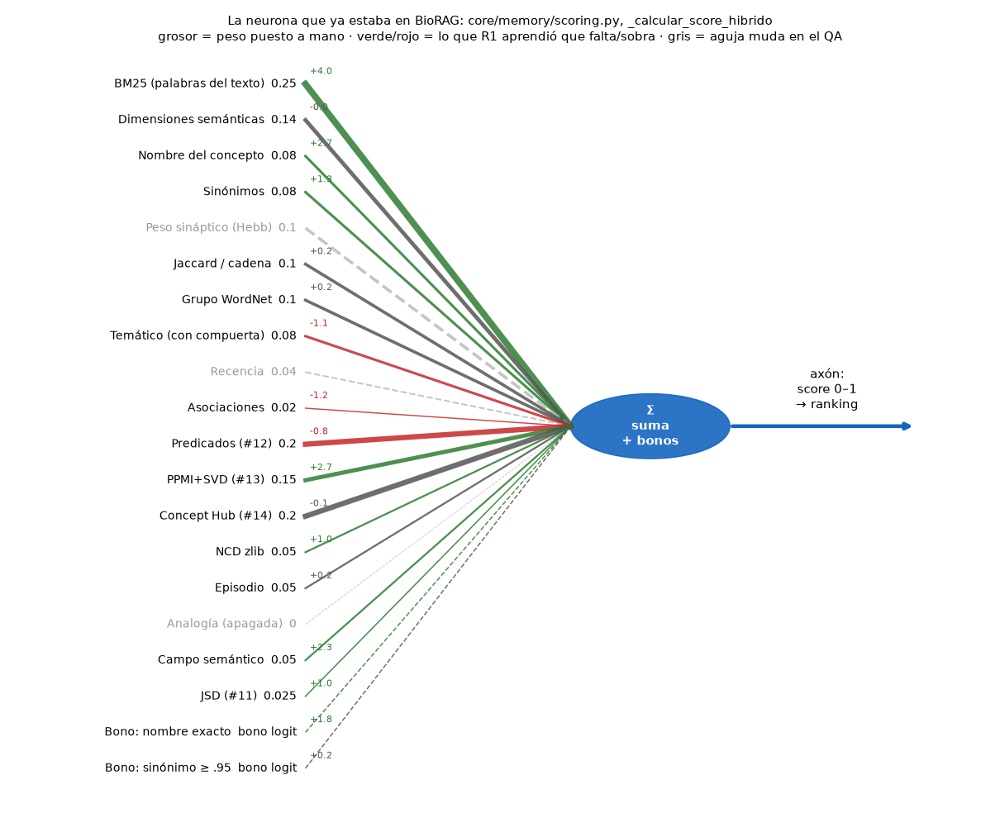
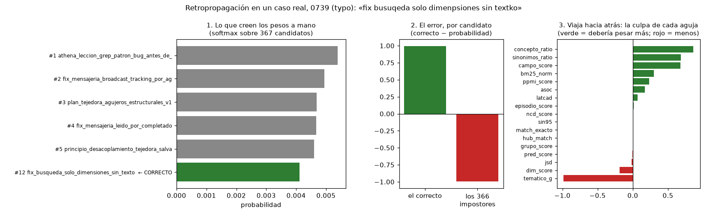
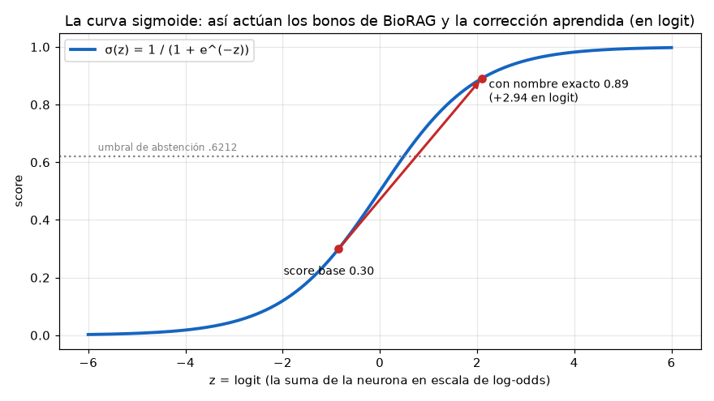
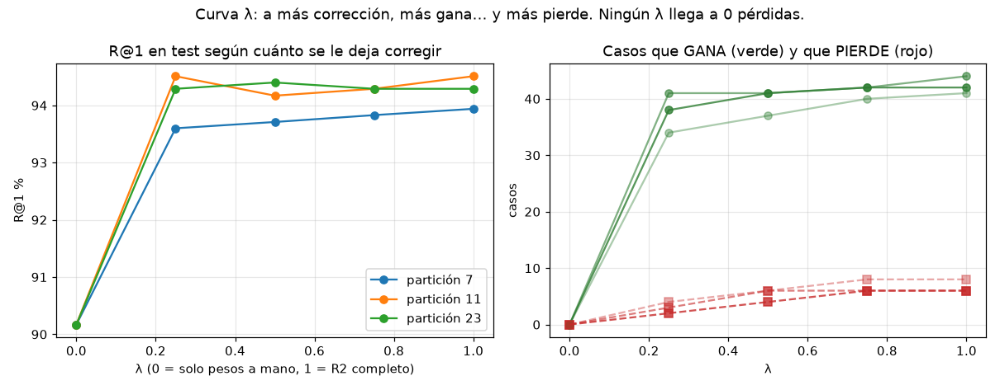
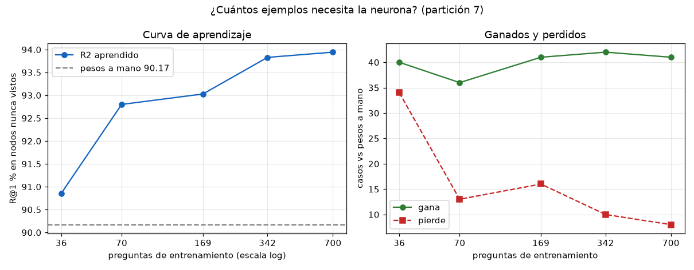
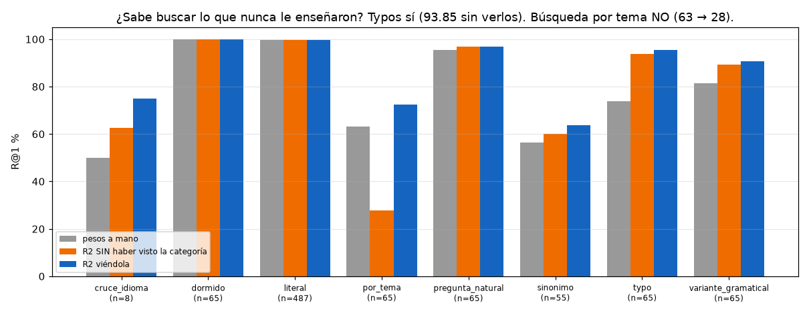

# La neurona de BioRAG, explicada de punta a punta

> Documento complementario del [README](README.md) del experimento 01. El README trae los números. Este documento explica **qué es cada pieza, por qué se comporta como se comporta y qué se puede y qué no se puede prometer**.
>
> Todas las cifras salen de archivos de `resultados/` y todas las figuras de `dibujar_curvas.py`. Nada se modificó en el motor, la DB ni el snapshot.

---

## 1. Sí: las señales son las agujas de la neurona

Una neurona, la biológica y la artificial de los videos, tiene cuatro partes. BioRAG ya las tenía todas en una sola función, `_calcular_score_hibrido`, en `core/memory/scoring.py:295-385`:

| Neurona | Qué hace | En BioRAG |
|---|---|---|
| **Dendritas** (tus "agujas") | Cada una capta un estímulo distinto | Cada **señal**: BM25, sinónimos, hub, PPMI… |
| **Sinapsis** (fuerza de cada aguja) | Decide cuánto cuenta ese estímulo | Cada **peso**: `0.25 * bm25_norm`, `0.20 * hub_match`… (líneas 343-364) |
| **Soma** (cuerpo) | Suma todo | La suma `score = base_weight * (...)` |
| **Disparo / axón** | Decide si sale señal y con qué fuerza | Los bonos en logit (líneas 369-383) y el score final entre 0 y 1, que ordena el ranking |



*Figura 1. Cada línea es una aguja. El grosor es el peso que pusiste a mano. El número verde o rojo es lo que la neurona aprendida (R1) dice que le falta (verde) o le sobra (rojo). En gris, las agujas que no captan nada durante el QA.*

### Cuántas agujas hay de verdad

El código las numera hasta la **#14** (`Signal #14: Concept Hub`). Por eso hablamos de "14 señales". Contándolas en la fórmula de hoy hay **20 agujas**:

- **18 con peso**: las 12 originales, PPMI (#13), cuatro agujas del pool (NCD, episodio, analogía y campo) y JSD (#11).
- **2 bonos** que actúan en la curva (§4): nombre exacto, y sinónimo ≥ .95.

En el QA que usa el experimento hay **3 agujas mudas**, y conviene que lo sepas:

1. **Peso sináptico (Hebb).** El QA lo apaga a propósito con `ignore_peso_sinaptico=True` (`search.py:1756`) para que la evaluación no dependa del uso previo. En producción sí funciona. La neurona entrenada **no aprendió cuánto confiar en ella**; habría que enseñárselo con datos de uso real.
2. **Recencia (`temporal`, peso .04).** **Está muda siempre, también en producción.** Ningún llamador le pasa ese parámetro: ni `search.py:1753` ni `rafaga.py:276`. Su peso sigue contando en el denominador de la normalización, así que le quita un poco de fuerza a todas las demás. Es un hallazgo de esta revisión y **no lo toqué**. Si se arregla, debe ir en un PR propio con QA antes y después.
3. **Analogía.** Está apagada por configuración (`ANALOGIA_PESO = 0`).

### Qué capta cada aguja

| # | Aguja | Qué estímulo capta | Peso a mano | Lo que la neurona aprendió (R1) |
|---|---|---|---|---|
| 1 | BM25 | Palabras de la consulta presentes en el texto del nodo (índice FTS5) | .25 | **+4.0**: la subestimabas mucho |
| 2 | Dimensiones | Coincidencia de etiquetas semánticas (tipo, dominio…) | .14 | ≈0 |
| 3 | Concepto | Palabras de la consulta en el **nombre** del nodo | .08 | **+2.7** |
| 4 | Sinónimos | Palabras de la consulta en los sinónimos del nodo | .08 | +1.3 |
| 5 | Peso sináptico | Fuerza hebbiana: cuánto se ha usado y reforzado el nodo | .10 | (muda en QA) |
| 6 | Jaccard / cadena | Solapamiento de conjuntos y cadenas latentes | .10 | +0.2 |
| 7 | Grupo WordNet | Mismo grupo semántico en WordNet | .10 | +0.25 |
| 8 | Temático | Presencia o ausencia de dimensiones ponderada por IDF; solo actúa si hay evidencia léxica | .08 | **−1.1**: la sobrevalorabas |
| 9 | Recencia | Lo reciente | .04 | (muda siempre) |
| 10 | Asociaciones | Cuántas asociaciones tiene el nodo | .02 | **−1.2**: favorece a los nodos "famosos" |
| 11 | JSD | Parecido de la distribución de palabras | .025 a .125 | +1.0 |
| 12 | Predicados | Coincidencia con predicados SRL (quién hace qué) | .20 | **−0.75** |
| 13 | PPMI+SVD | Significado aprendido de la co-ocurrencia en tu propio corpus, sin modelo de embeddings | .15 | **+2.7** |
| 14 | Concept Hub | El nodo pertenece a un hub de paráfrasis activado por la consulta | .20 | −0.1 en promedio, pero depende del contexto: ver §3, el XOR |
| 15 | NCD | Distancia por compresión zlib: capta trozos compartidos, útil con typos | .05 | +1.0 |
| 16 | Episodio | Afinidad temporal entre recuerdos del mismo episodio | .05 | +0.2 |
| 17 | Analogía | Analogía relacional en PPMI | 0 | (apagada) |
| 18 | Campo semántico | Potencial de campo en el espacio PPMI | .05 | **+2.3** |
| 19 | Bono nombre exacto | +2.94 en logit si la consulta es el nombre del nodo | — | +1.8 |
| 20 | Bono sinónimo ≥ .95 | Lleva el score a ~.70 + .10·PPMI | — | +0.2 |

**Cómo leer la última columna.** Las correcciones de R1 están en la escala del logit, no en la de tus pesos. Por eso no se suman a .25: dicen **hacia dónde** debería moverse cada aguja y **con qué fuerza relativa**. Fuente: `resultados/particion_7.txt`, sección final.

---

## 2. Cómo llegaste a esto, sin saberlo

Revisando el historial del repo, el patrón es este:

1. Añadiste una aguja nueva cuando el sistema fallaba en un tipo de consulta: predicados, PPMI, hub, NCD…
2. Le pusiste un peso a mano.
3. Corriste el QA y ajustaste el peso hasta que dejó de romper otras cosas.

Eso es exactamente lo que se hacía **antes de que existiera el aprendizaje automático**: cada peso era un experimento manual. El video 2 lo cuenta así: *"Con eso se arma cualquier función lógica, pero los pesos se ponían a mano, no aprendía nada"* (McCulloch y Pitts, 1943).

| Historia (video 2) | En BioRAG |
|---|---|
| 1943, McCulloch-Pitts: suma y umbral, **pesos a mano** | `_calcular_score_hibrido` hoy: modelo **M0** |
| 1958, Rosenblatt: el perceptrón **aprende**; si se equivoca, mueve cada peso un poquito | Modelo **P** del experimento |
| 1969, Minsky y Papert: **el XOR**, ninguna recta lo separa | La aguja **hub**: en unas consultas salva el resultado y en otras lo hunde. Ningún peso fijo sirve para todos los casos (README §4) |
| 1986, **retropropagación**: el error viaja hacia atrás, capa por capa | Modelo **R2**, con capa oculta de 6 neuronas |
| 2017, Transformer: la consulta "mira" y decide a qué prestar atención (softmax) | Modelo **R3**, la compuerta según la consulta. También el softmax sobre el pool con el que se entrena todo |

Lo valioso no es que hayas usado una neurona, sino que **las agujas que fuiste construyendo captan cosas reales y bien elegidas**. Por eso la neurona aprendida ya parte de 90 % y llega a 94 %.

---

## 3. El XOR de BioRAG: por qué hace falta una capa oculta

Con una sola capa (P o R1), cada aguja tiene **un** peso para todas las consultas. La aguja **hub** muestra el límite:

- En la suite Concept Hub **rescata paráfrasis** (de 0/5 a 5/5).
- En el QA, cuando decide el primer puesto, **se equivoca 12 de 17 veces**.

Que el hub ayude o estorbe depende de **otra** aguja: ¿hay coincidencia en el nombre o en el texto? Es la misma forma del XOR. La capa oculta de R2 combina agujas ("hub sí, pero solo si no hay match léxico fuerte"), y por eso R2 gana más que R1 y pierde menos (§5).

---

## 4. "Mandan la negativa para atrás": la retropropagación, en tu código

Lo que recuerdas de los videos son dos ideas que van juntas.

**a) El error viaja hacia atrás.** El video 2 lo dice así: *"Si la red se equivoca, ¿cuánta culpa tiene cada peso? La respuesta es la regla de la cadena… El error viaja hacia atrás, capa por capa."*

**b) Los negativos.** En cada pregunta hay un nodo correcto y cientos de **impostores**, los demás candidatos del pool. La neurona aprende de los dos a la vez:

- el correcto se empuja **hacia arriba**;
- cada impostor se empuja **hacia abajo**, en proporción a cuánta probabilidad le "robó" al correcto.

Esto no ocurre solo "cuando no aprende bien": el error se envía **siempre**, y es tanto más grande cuanto más se equivocó.

En `entrenar_neurona.py`, son literalmente estas líneas:

```python
pr = np.exp(s); pr /= pr.sum()          # L136: lo que cree la neurona (softmax del pool)
d = pr.copy(); d[c["y"]] -= 1.0         # L138: el ERROR de cada candidato (correcto: prob − 1; impostor: prob)
grads["v"] += H.T @ d                   # L146: culpa de los pesos de salida
dH = np.outer(d, self.p["v"]) * (1 - H ** 2)   # L147: el error VIAJA HACIA ATRÁS a la capa oculta
grads["W"] += dH.T @ X                  # L148: culpa de cada aguja en cada neurona oculta
self.p[k] -= lr * mh / (np.sqrt(sh) + 1e-8)    # L161: la "pelota rueda hacia el valle" (descenso de gradiente, Adam)
```

La figura 5 lo muestra en un caso real, el **0739** (un typo): `fix busuqeda solo dimenpsiones sin textko`.



*Figura 5. Panel 1: con tus pesos a mano, el nodo correcto queda en el puesto 12 de 367. Panel 2: el error total, +1 para el correcto y −1 repartido entre los 366 impostores. Panel 3: la culpa que recibe cada aguja.*

Lo que aprende en este caso es lo que aprende en promedio:

- **subir** concepto, sinónimos, campo, BM25 y PPMI;
- **bajar** temático y dimensiones.

Una sola pregunta ya "dice" lo mismo que los 700 casos de entrenamiento juntos. Con los pesos aprendidos, el caso 0739 sube al **puesto 1** en las tres particiones.

---

## 5. Todas las curvas

### 5.1 La curva sigmoide: cómo actúan los bonos



**Precisión importante.** En BioRAG la suma principal es **lineal**, como un regulador de luz: no pasa por una curva. La sigmoide solo aparece:

- en los **bonos**: el nombre exacto suma +2.94 en logit, y un nodo con score .30 pasa a .89;
- en la **corrección aprendida**: R1, R2 y R3 suman su corrección en logit, sobre la misma curva.

La curva tiene una consecuencia práctica: **un mismo empujón mueve mucho a un candidato del medio (~.5) y poco a uno de los extremos**. Así la neurona puede cambiar el orden entre los candidatos dudosos sin tocar los que ya están claros.

### 5.2 La curva λ: cuánto se le deja corregir a la neurona



λ mide cuánta corrección aprendida se aplica:

- λ = 0 son tus pesos de hoy, intactos;
- λ = 1 es R2 completo.

Lo que muestra la curva:

- **Casi toda la ganancia llega con poco**: con λ = .25, R@1 sube de 90.17 a 93.60–94.51.
- **Las pérdidas crecen con λ**: de 2–4 casos con λ = .25 a 6–8 con λ = 1.
- **Ningún λ llega a 0 pérdidas.** Esa es la razón técnica por la que, con tu regla de "nunca baja", hace falta además una **compuerta por caso** o una **lista de pérdidas revisada** (README §8).

### 5.3 La curva de aprendizaje: cuántos ejemplos necesita



Fuente: `resultados/curva_aprendizaje_7.txt`. El entrenamiento usa solo una fracción de los nodos y el test se hace siempre con **nodos que la neurona nunca vio**.

| Preguntas de entrenamiento | R@1 | Gana / pierde vs pesos a mano |
|---|---|---|
| 0 (pesos a mano) | 90.17 | — |
| 36 | 90.86 | +40 / **−34** |
| 70 | 92.80 | +36 / −13 |
| 169 | 93.03 | +41 / −16 |
| 342 | 93.83 | +42 / −10 |
| 700 | 93.94 | +41 / −8 |

**Lectura:**

- Con **~70 preguntas** ya se obtiene la mayor parte de la mejora.
- **Con muy pocos datos la neurona es peligrosa**: con 36 preguntas gana 40 casos pero rompe 34. En una base nueva, la neurona **no debe** aprender de los primeros ejemplos sin freno (λ pequeño y compuerta).

### 5.4 Entrenamiento frente a test

R2 acierta 95.5 % en las preguntas con las que entrenó y 93.9 % en nodos nuevos. La diferencia es pequeña, así que **no está memorizando**; está aprendiendo reglas que sirven para nodos que no vio.

---

## 6. ¿De qué aprende la neurona? (y la trampa a vigilar)

**No aprende del contenido de tus 866 nodos.** Aprende de las **921 preguntas del QA**, cada una con su nodo correcto. Esas preguntas **no las escribió una persona**: las generó automáticamente `scripts/generar_casos_qa.py` a partir de cada nodo.

| Categoría | Cómo se genera la pregunta |
|---|---|
| literal / dormido | El nombre del nodo |
| typo | Una letra cambiada, borrada o insertada al azar |
| variante gramatical | Reglas de sufijo (`-cion` a `-ciones`, `-o` a `-ando`…) |
| sinónimo | Un sinónimo del nodo o de un mapa fijo |
| cruce de idioma | Un diccionario de unas 40 palabras español-inglés |
| pregunta natural | 6 plantillas ("¿Qué tenemos registrado para…?") |
| por tema | 3 palabras al azar del **contenido** que no estén en el nombre |

**Lo bueno, y es la clave para "la base de otra persona":** como las preguntas se generan solas, **cualquier base nueva puede fabricar su propio examen y su propio entrenamiento**, sin etiquetas humanas.

**La trampa:** la neurona puede aprender **los hábitos del generador** en lugar de cómo busca una persona real. Por ejemplo, la gran ganancia en typos (+14 casos) se aprendió con typos de una sola letra al azar; los humanos se equivocan distinto. Por eso el examen definitivo debe hacerse con **consultas reales**: las búsquedas que hacen tus agentes por MCP y lo que marcan con `feedback(util)`.

---

## 7. La base en blanco de otra persona: qué se transfiere y qué no

### 7.1 Lo que juega a favor

- **La neurona nunca ve palabras**, solo 17 números por candidato ("¿cuánto captó cada aguja?"). No sabe nada de "Athena" ni de "hormiguita". Aprende **cuánto confiar en cada tipo de evidencia**, y eso tiene sentido en cualquier corpus. Un modelo de palabras no podría transferirse así.
- **Arranque seguro.** Si la corrección aprendida es 0, la neurona **es exactamente tu fórmula de hoy**. Una base nueva nunca empieza peor que BioRAG actual.

### 7.2 Lo que juega en contra

- **Con una base vacía o pequeña, varias agujas callan o hacen ruido.** Hub, PPMI, campo, predicados, asociaciones y peso sináptico **se construyen con el uso y el tamaño del corpus**. Una neurona entrenada en tu base, donde esas agujas hablan, podría confiar demasiado en ellas cuando todavía no saben nada.
- **Nunca lo hemos medido en un segundo corpus.** Todo lo de este experimento es tu base. Es la pregunta abierta número 1.

### 7.3 Experimento B: ¿sabe buscar lo que nunca le enseñaron?

Es el experimento más cercano a esa pregunta que puede hacerse hoy. Para cada categoría, se entrena la neurona **sin ningún ejemplo de ella** y se evalúa solo en ella.



| Categoría | Pesos a mano | R2 **sin** haberla visto | R2 viéndola |
|---|---|---|---|
| typo | 73.85 | **93.85** (+13 / −0) | 95.38 |
| variante gramatical | 81.54 | 89.23 (+7 / −2) | 90.77 |
| sinónimo | 56.36 | 60.00 (+5 / −3) | 63.64 |
| cruce de idioma (n = 8) | 50.00 | 62.50 (+1 / −0) | 75.00 |
| pregunta natural | 95.38 | 96.92 (+2 / −1) | 96.92 |
| literal / dormido | 99.59 / 100 | igual | igual |
| **por tema** | **63.08** | **27.69 (+4 / −27)** | 72.31 |

Este es el resultado más importante del documento, en las dos direcciones:

- **Sí generaliza** a typos, variantes y sinónimos sin haberlos visto. Aprendió algo general: "confía en el nombre, el texto y PPMI, desconfía de la popularidad".
- **Se estrella en la búsqueda por tema.** Es justo lo que tú quieres: "te llegan cosas que no tienen las mismas palabras pero tienen que ver". Sin ejemplos de ese tipo, la neurona aprende a confiar tanto en el nombre que **hunde** los resultados temáticos, de 63 % a 28 %.

**Regla que sale de aquí: la neurona solo aprende a buscar por significado si se le enseña con preguntas por significado.** El generador de preguntas de cualquier base nueva tiene que incluirlas siempre.

### 7.4 El camino propuesto para cualquier base

Son tres capas; todas son propuestas y ninguna está implementada:

1. **Pesos de fábrica.** La neurona entrenada en tu base, aplicada con λ pequeño. Si una aguja todavía calla, la corrección no puede inventar nada.
2. **Autoentrenamiento con su propio corpus.** Cuando la base tenga suficientes nodos (con ~70 preguntas ya se ve el efecto, pero con freno), se generan preguntas de **sus** nodos con `generar_casos_qa.py`, incluyendo las de tema. Se re-entrena y **solo se adoptan los pesos nuevos si la compuerta por caso no pierde nada** en su examen.
3. **Aprendizaje continuo.** Cada `feedback(util)` real es un ejemplo más, con el mismo freno.

---

## 8. "Buscar y que llegue lo relacionado aunque no use las mismas palabras": qué puede hacer la neurona y qué no

Es la parte más importante para no prometer lo que no es.

- **La neurona no crea significado; lo pondera.** Decide cuánto creerle a cada aguja. Si **ninguna aguja capta** que "vehículo" y "carro" son lo mismo, ningún peso, aprendido o a mano, lo va a encontrar.
- **El "pacatán" sale de las agujas semánticas**: sinónimos, grupo WordNet, PPMI+SVD, campo semántico, hub y dimensiones. La neurona ayuda a que esas agujas pesen lo justo en cada contexto (la capa oculta del §3).
- **Primero el nodo tiene que llegar al pool.** La neurona solo reordena candidatos. En este QA el nodo correcto estaba en el pool en 875 de 875 casos, pero en un corpus grande, encontrar candidatos por significado es un trabajo aparte del de ordenarlos.

Por tanto, para lo que buscas hay que trabajar en las dos piezas:

- **mejores agujas semánticas**, que capten significado;
- **una neurona que aprenda a escucharlas**, entrenada con preguntas de significado.

---

## 9. ¿Es algo único?

La respuesta honesta, para que puedas defenderla ante un auditor:

- **No es nuevo** que una neurona aprenda a combinar señales de búsqueda. Se llama *learning to rank* y existe desde 2005 (RankNet, LambdaMART). Los buscadores grandes lo usan.
- **Lo que sí es poco común** es la combinación que tiene BioRAG:
  - agujas **bioinspiradas** (Hebb, sueño y consolidación, hubs, campos);
  - todo **sin modelo de embeddings ni GPU**, dentro de SQLite;
  - una neurona que **arranca exactamente desde los pesos de su inventor**, con un freno (λ) que garantiza no empezar peor;
  - **explicable aguja por aguja**: puedes ver la culpa de cada una en cada consulta (figura 5);
  - capaz de **fabricar su propio examen** en cualquier corpus nuevo.
- Para decir "**jamás nadie lo ha hecho**" haría falta una búsqueda exhaustiva de la literatura, que no he hecho. "**Un enfoque propio, diferente y medido**" sí se puede afirmar con estos datos.

---

## 10. Pendientes que salen de este documento

1. **Determinismo** (README §5): sin él, "nunca baja" no se puede verificar.
2. **Recencia muda en producción** (§1): decidir si se conecta o se quita su peso del denominador. Va en un PR aislado con QA antes y después.
3. **Peso sináptico**: medir la neurona con datos de uso real, porque el QA lo apaga.
4. **Segundo corpus** para medir la transferencia de verdad (§7.2): por ejemplo, la base de otro agente o documentos públicos, con QA generado por `generar_casos_qa.py`.
5. **Consultas reales** como examen definitivo (§6).
6. **Los 5 casos por tema que siempre se pierden** (0504, 0596, 0640, 0688 y 0842) y el colapso de "por tema" sin ejemplos (§7.3).

---

## Reproducir este documento

```bash
cd "docs/Mi neurona en el sistema/experimento_01_pesos_aprendidos"
PYTHONHASHSEED=1 python exportar_senales.py                # datos/  (~10 min, una vez)
python entrenar_neurona.py --semilla-folds 7 > resultados/particion_7.txt   # (y 11, 23)
python curva_aprendizaje.py --semilla-folds 7 > resultados/curva_aprendizaje_7.txt   # ~8 min
pip install matplotlib && python dibujar_curvas.py         # figuras/
```
