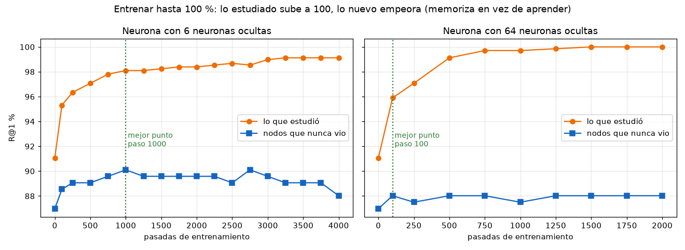
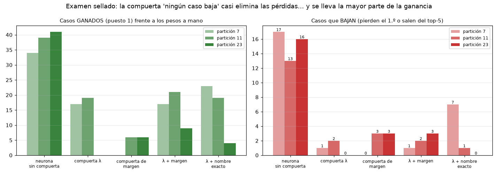

# Experimento 02: aprender sin hacer trampa, con examen sellado y la regla "ningún caso baja"

- **Fecha:** 2026-10-22.
- **Rama:** `arena/720a0807-memorybiorag`.
- **Estado:** experimento offline. **No modifica el motor, la DB ni el snapshot.**
- **Viene de:** [experimento 01](../experimento_01_pesos_aprendidos/README.md) y su [explicación](../experimento_01_pesos_aprendidos/LA_NEURONA_EXPLICADA.md). Usa las mismas señales, el mismo modelo R2 y los mismos datos.

---

## 1. La idea de Dennys

> "El cómo puede aprender es que los recall y todo lo demás lleguen a 100, ese es el tope. Si ve que no llegó… aumenta los pesos y así hasta que esa misma neurona puede ser perfecta. Que el QA pase como validador."

La idea tiene dos partes. Este experimento mide cada una:

1. **Ajustar los pesos hasta llegar a 100 %.** Es el bucle de entrenamiento: medir el error, mover los pesos y repetir. → Parte A.
2. **Usar el QA como validador**, de modo que los pesos nuevos solo entren si ningún caso baja. → Parte B.

---

## 2. Parte A: entrenar hasta 100 %

R2 se entrena **sin freno**, sin regularización, hasta sacar 100 % en las preguntas que estudia. A la vez se mide en nodos que **nunca vio**.



| Neurona | Pasadas | R@1 en lo estudiado | R@1 en nodos nuevos |
|---|---|---|---|
| (pesos a mano) | 0 | 91.07 | 86.98 |
| 6 ocultas | 1 000 | 98.10 | **90.10**, su mejor punto |
| 6 ocultas | 4 000 | 99.12 | 88.02 |
| 64 ocultas | 1 500 | **100.00** | 88.02 |
| 64 ocultas | 2 000 | 100.00 | 88.02 |

Fuente: `resultados/parte_A_7.txt`. Estudio = 683 preguntas; nodos nuevos = 192 preguntas.

**Conclusión.** La neurona **sí llega a 100 %, pero memorizando**. Pasado su mejor punto, cuanto más se acerca al 100 en lo estudiado, peor responde a lo nuevo. Es el alumno al que le dan las respuestas del examen. **El 100 % en lo estudiado no puede ser el criterio para parar.**

---

## 3. Parte B: la versión correcta de la idea

En cada una de **5 rotaciones**, los nodos se reparten en tres grupos que no se mezclan:

| Grupo | Parte | Para qué |
|---|---|---|
| **Estudio** | 3/5 | La neurona aprende de aquí. |
| **Validación** | 1/5 | Decide **cuándo parar**: el entrenamiento se detiene cuando la validación deja de mejorar (parada temprana). |
| **Examen sellado** | 1/5 | Se mira **una sola vez**, al final. Es el número honesto. |

Al terminar las 5 rotaciones, cada una de las 875 preguntas ha sido examen sellado exactamente una vez.

### Las compuertas "ningún caso baja"

Las cuatro se calibran con el material **visto** (estudio + validación), nunca con el examen:

| Compuerta | Qué hace |
|---|---|
| **λ** | Aplica solo una fracción λ de la corrección aprendida. Se elige el **mayor λ que no baja ningún caso** visto. |
| **Margen** | La neurona solo puede tocar las consultas donde los pesos a mano **dudan**, es decir, cuando la diferencia entre el 1.º y el 2.º es pequeña. |
| **λ + margen** | Combina las dos. |
| **λ + nombre exacto** | Si el 1.º de los pesos a mano coincide **exactamente con el nombre**, la neurona no toca esa consulta. *Regla añadida después de ver el caso 0274 en la partición 7; ver §4.* |

"Bajar" significa **perder el 1.º puesto** o **salir del top-5** frente a los pesos a mano.

### Resultado en el examen sellado: 3 particiones × 5 rotaciones

| Versión | R@1 (7 / 11 / 23) | Gana | Pierde 1.º | Sale del top-5 |
|---|---|---|---|---|
| Pesos a mano (hoy) | 90.17 | — | — | — |
| Neurona sin compuerta | 93.14 / 93.83 / 93.94 | +34 / +39 / +41 | 8 / 7 / 8 | 9 / 6 / 8 |
| Compuerta λ | 92.00 / 92.23 / 90.17 | +17 / +19 / **+0** | 1 / 1 / 0 | 0 / 1 / 0 |
| Compuerta de margen | 90.17 / 90.74 / 90.86 | +0 / +6 / +6 | 0 / 1 / 0 | 0 / 2 / 3 |
| λ + margen | 92.00 / 92.46 / 91.20 | +17 / +21 / +9 | 1 / 1 / 0 | 0 / 1 / 3 |
| λ + nombre exacto | 92.46 / 92.34 / 90.63 | +23 / +19 / +4 | **3** / 0 / 0 | **4** / 1 / 0 |

Fuentes: `resultados/parte_B_{7,11,23}.txt` y `.json`. Los JSON traen la lista exacta de casos ganados y perdidos.



---

## 4. Qué significa

1. **La compuerta funciona a medias.** Hace bajar los casos perdidos de 13–17 a 0–3 (salvo λ + nombre exacto en la partición 7, con 7; ver punto 3), pero también se lleva **la mitad o más de la ganancia**: de +34–41 a 0–23. En la partición 23, la compuerta λ dejó la neurona **totalmente apagada** (λ = 0 en las 5 rotaciones), porque cualquier corrección bajaba algún caso visto.

2. **"Cero pérdidas en lo visto" no garantiza "cero pérdidas en lo nuevo".** Pasó en todas las compuertas: casos que nunca vio bajan igual (0274, 0516, 0803…). **La compuerta también se ajusta a lo que vio**, y por tanto también puede sobreajustarse.

3. **El caso de la regla del nombre exacto es la lección más clara.** El caso 0274 (`mcp-primitiva-externa-definicion-2`) se perdía porque hay dos nodos casi idénticos con score .9488 y .9484, una moneda al aire. La regla "si el 1.º es el nombre exacto, no tocar" lo arregla. Pero al proteger esos casos, la calibración se atreve con un λ mayor, y **en la misma partición 7 rompe otros 3 casos** (0708, 0735, 0842) y saca 4 del top-5. En las particiones 11 y 23, que no se usaron para diseñarla, deja 0 casos sin el 1.º puesto, pero 1 caso igual sale del top-5. **Una regla diseñada mirando un fallo concreto no es una garantía**: hay que volver a probarla en datos que nunca vio, como se hizo aquí.

4. **Los casos que más se resisten son preguntas débiles del generador**, no fallos claros de la neurona. Por ejemplo:
   - 0516, por tema: `real más sistemas` → `dennys-identidad-profunda`;
   - 0634, por tema: `paráfrasis vectores búsqueda` → `arquitectura_dos_niveles_biorag`.

   Son 3 palabras al azar del contenido (`scripts/generar_casos_qa.py`) y a veces otro nodo es igual de válido. Antes de exigir "cero pérdidas", conviene **revisar si esas etiquetas son justas**.

5. **El 100 % es el horizonte, no el criterio de parada.**
   - Hay 6 consultas con etiqueta contradictoria.
   - Hay preguntas "por tema" ambiguas.
   - Hay pares de nodos que ninguna aguja distingue.

   El criterio correcto es: **lo más alto posible en el examen sellado, con la regla de no bajar comprobada caso por caso.**

---

## 5. Limitaciones

- **Rango antes del post-proceso.** Como en el experimento 01, se compara el orden de `_calcular_score_hibrido`. El post-proceso del motor (léxico, QCR, hub, convergencia) lleva hoy el R@5 oficial a 100 %, así que **varias de las salidas del top-5 de aquí probablemente las rescataría**. El resultado de punta a punta solo se conoce integrando la neurona detrás de un flag y corriendo `evaluar_qa.py` completo.
- **Un solo corpus**: el de Dennys. Las preguntas son generadas, no consultas reales.
- **Determinismo pendiente.** El motor aún depende de `PYTHONHASHSEED`; la exportación usa `PYTHONHASHSEED=1`.

---

## 6. Recomendación

1. **Determinismo primero** (`search.py:724`). Sin él, "ningún caso baja" no se puede verificar ni en local.
2. **Revisar las etiquetas débiles** del generador (por tema y cruce de idioma), empezando por 0516, 0634, 0274, 0803 y los 5 casos recurrentes del experimento 01.
3. **Integrar R2 detrás de `BIORAG_NEURONA=0`**, con la compuerta λ, y medir **de punta a punta** con `evaluar_qa.py`. El QA completo será el validador final que propone Dennys: si cualquier caso baja, no se adopta.
4. **Decisión pendiente de Dennys:**
   - **Regla estricta.** Hoy significa una neurona casi apagada: +0 a +19 casos.
   - **Ganancia neta con lista de pérdidas revisada a mano.** Hoy da unos +35–41 casos con 13–17 a revisar, antes del post-proceso.

---

## 7. Reproducir

Necesita la exportación del experimento 01 (`../experimento_01_pesos_aprendidos/datos/pools_semilla1.jsonl.gz`). Si no existe, se regenera en unos 10 minutos con `PYTHONHASHSEED=1 python ../experimento_01_pesos_aprendidos/exportar_senales.py`.

```bash
cd "docs/Mi neurona en el sistema/experimento_02_examen_sellado"
python entrenar_con_examen_sellado.py --parte A --semilla-folds 7  > resultados/parte_A_7.txt   # ~8 min
for s in 7 11 23; do
  python entrenar_con_examen_sellado.py --parte B --semilla-folds $s > resultados/parte_B_$s.txt  # ~10 min c/u
done
python dibujar.py      # figuras/ (requiere matplotlib)
```

**Verificación hecha al publicar:**
- La exportación se **regeneró desde cero** en un entorno nuevo, y `entrenar_neurona.py --semilla-folds 7` reprodujo `particion_7.txt` y sus rangos **idénticos**. La reproducción del experimento 01 funciona.
- Repetir la parte B de la partición 7 tras añadir la compuerta del nombre exacto dio resultados idénticos en las 4 versiones anteriores.
- SHA-256 del snapshot antes y después: `104dd2902aaf24c3…`, sin cambios.

| Archivo | Contenido |
|---|---|
| `entrenar_con_examen_sellado.py` | Partes A y B. Importa señales y modelo de `../experimento_01_pesos_aprendidos/entrenar_neurona.py`. |
| `dibujar.py` | Figuras A y B. |
| `resultados/parte_A_7.{txt,json}` | Curvas de "entrenar hasta 100". |
| `resultados/parte_B_{7,11,23}.{txt,json}` | Examen sellado por partición, con la lista de casos ganados y perdidos por versión. |
| `figuras/` | `A_hasta_100.png` y `B_examen_sellado.png`. |
