# Experimento 11 — La neurona asociativa "de nacimiento"

> **Pedido de Dennys:** *"Ármate la neurona que usa el ser humano cuando va a guardar información y
> enlazar información… lo más parecido o exactamente igual."* Que decida si dos recuerdos **de
> verdad** tienen que ver, que venga **ya calibrada de fábrica** (como nacemos con neuronas listas),
> que **no** se entrene con la memoria de la persona y que funcione en **cualquier** memoria.
>
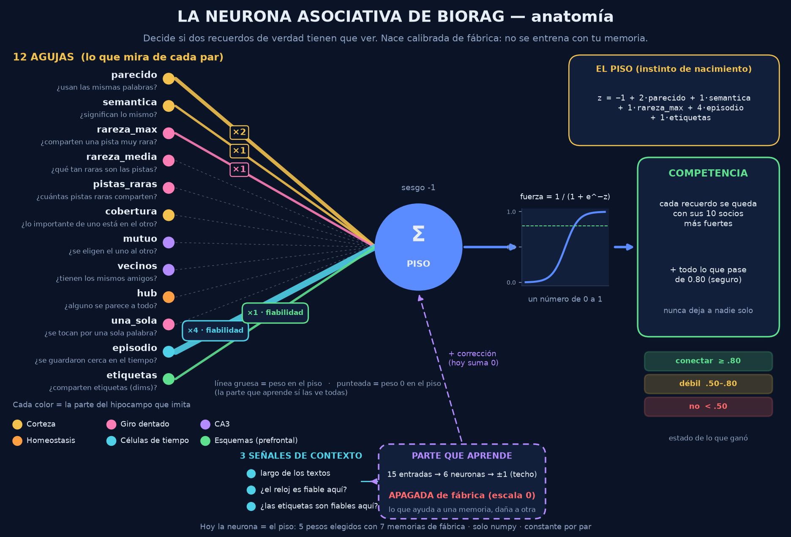

> **Hay una versión 2 más abajo (PARTE 2, sección V2.0).** Todos los dibujos están en la sección V2.14. Responde a la revisión externa de la v1,
> agrega 4 memorias (español, portugués, código y chat), el tiempo y las etiquetas. Lo de esta parte
> es la v1 y queda como historia.
>
> **Estado:** experimento. **No se cambió ni una línea del motor. No se tocó ninguna DB real.** La
> memoria de Dennys se leyó desde una **copia** del snapshot, solo lectura.

---

## 0. En pocas líneas

| Pregunta | Respuesta corta |
|---|---|
| ¿Se pudo armar? | Sí. 10 agujas universales + piso a mano + una corrección chiquita de fábrica. Solo numpy. |
| ¿Funciona en una memoria que nunca vio? | Sí. Se entrenó con 2 memorias y se examinó en la 3ª (x3). AUC **.878 / .903 / .981**. |
| ¿Y en la memoria real de Dennys (español, técnica, nunca vista)? | Ordena los enlaces que puso una persona **por encima** de los mecánicos: AUC **.859**. El peso que el motor usa hoy da **.271** (los pone **por debajo**). |
| ¿Qué tanto ayuda en la práctica? | Si cada recuerdo se queda con sus **10** socios más fuertes, se queda con el **41 %** de las conexiones de hoy y conserva el **83 %** de las humanas. Con el peso de hoy, en el mismo cupo, solo el **26 %** de las humanas. |
| ¿La parte que "aprende" ayuda? | Casi nada todavía. Lo que viaja de una memoria a otra es el **instinto** (el piso a mano). Lo digo claro en la sección 6. |
| ¿El umbral fijo sirve en cualquier memoria? | **No.** En la memoria de Dennys marcaría "no" al 94 % de lo que hay. Por eso la decisión final es por **competencia** (cada recuerdo se queda con sus mejores socios), no por un número fijo. |
| ¿Es perfecta? | **Todavía no.** Hay enlaces humanos que no puede ver porque al motor le faltan capas (el **momento** en que se guardó, sobre todo). Sección 9. |
| ¿Ya está en el motor? | **No.** Este experimento solo prueba la neurona. Cablearla y pasar el QA es el paso siguiente, con tu permiso. |

---

## 1. Qué hace un humano cuando guarda y enlaza (y qué copiamos)

Cuando guardas algo nuevo, el **hipocampo** decide con qué recuerdos viejos se une. A grandes rasgos:

| Parte del cerebro | Qué hace | En esta neurona |
|---|---|---|
| **Corteza entorrinal** | Entrega al hipocampo un resumen de lo que estás viviendo | Las **agujas** (sección 2): cada par de recuerdos se describe con 10 números |
| **Giro dentado** | Separa lo parecido pero distinto. Le da peso a lo **raro**: un detalle raro compartido dice mucho, uno común no dice nada | Agujas `rareza_max`, `rareza_media`, `pistas_raras` |
| **CA3** | Completa patrones: si dos cosas tienen los mismos "vecinos", se asocian | Agujas `vecinos`, `cobertura` (y el grafo del motor, que ya existe) |
| **CA1 + inhibición lateral** | Compara y decide. Solo los mejores socios ganan (k-ganadores) | Aguja `mutuo` y la regla de **competencia** (sección 7) |
| **Homeostasis (escalado sináptico)** | Una neurona que se dispara con todo pierde fuerza | Aguja `hub` (recuerdo que se parece a todo = poco fiable) |
| **Nacer con circuitos listos** | No aprendemos de cero a reconocer qué se parece: venimos calibrados | **Pesos de fábrica** congelados (`pesos_fabrica.json`) |
| **El momento / episodio** | Lo que vives junto se une aunque no se parezca | **FALTA en el motor** (sección 9) |

---

## 2. Las agujas (la entrada de la neurona)

Una aguja es un número de 0 a 1 sobre un **par** de recuerdos (A, B). Son **universales**: no miran
*qué* palabras hay, sino *cómo* se relacionan los dos recuerdos **dentro de su propia memoria**. Por
eso sirven en cualquier idioma y tema. Todo sale de los textos, nada viene de afuera
(`agujas.py`).

| Aguja | Qué pregunta |
|---|---|
| `parecido` | ¿Se parecen sus palabras? (coseno tf-idf) |
| `semantica` | ¿Se parecen en significado, aunque usen otras palabras? (LSA de 100 dimensiones) |
| `rareza_max` | ¿Cuál es la pista compartida más rara? |
| `rareza_media` | ¿Qué tan raras son, en promedio, las pistas compartidas? |
| `pistas_raras` | ¿Cuántas pistas raras distintas comparten? |
| `cobertura` | ¿Qué parte de lo importante del más corto está en el otro? |
| `mutuo` | ¿A está entre los más cercanos de B **y** B entre los de A? |
| `vecinos` | ¿Tienen los mismos vecinos cercanos? |
| `hub` | ¿Alguno de los dos se parece "a todo"? (resta) |
| `una_sola` | ¿Se tocan por **una sola** palabra? (resta; tu regla) |

Se probó una 11ª aguja, `corto` (¿alguno es muy corto?). No separa nada (AUC ~.50) y se sacó.

Detalles universales: sin lista de palabras vacías de ningún idioma. Una palabra que sale en más del
15 % de los recuerdos se trata como "relleno" **en esa memoria**. La raíz de una palabra son sus
primeras 7 letras (`busqueda`/`busquedas` → `busqued`).

---

## 3. Las memorias de fábrica (donde "nace" la neurona)

Para calibrar hace falta saber la verdad: qué pares **sí** tienen que ver. Usé tres memorias públicas
muy distintas entre sí, cada una con una verdad conocida (`corpus.py`):

| Memoria | Qué es | "Sí tienen que ver" cuando… | Recuerdos | Pares | Sí |
|---|---|---|---|---|---|
| **noticias** | Reuters (inglés) | tratan el mismo tema | 2,000 | 43,574 | 28.4 % |
| **diccionario** | WordNet (inglés) | WordNet los une directo (es-un, parte-de, opuesto…) | 2,000 | 40,225 | 2.9 % |
| **relatos** | Brown (inglés), trozos de 150 palabras | son trozos del **mismo** texto | 1,200 | 27,195 | 5.8 % |

Los pares no son al azar: son los que un motor mecánico **propondría** (comparten raíz o son vecinos
cercanos), hasta 30 por recuerdo. Así la neurona se entrena justo en la decisión difícil que va a
tener que tomar en el motor.

Los casos dudosos (por ejemplo, dos palabras de WordNet a 2 pasos) no se usan ni para entrenar ni
para medir.

---

## 4. Banco de calibración: qué separa cada aguja

AUC = probabilidad de que un par que **sí** tiene que ver saque más puntaje que uno que **no**.
0.5 es azar y 1.0 es perfecto. (`resultados/banco_calibracion.json`)

| Aguja | noticias | diccionario | relatos |
|---|---|---|---|
| parecido | .859 | .922 | .961 |
| semantica | .900 | .698 | .968 |
| rareza_max | .720 | .881 | .891 |
| rareza_media | .675 | .819 | .808 |
| pistas_raras | .612 | .829 | .905 |
| cobertura | .811 | .809 | .910 |
| mutuo | .850 | .926 | .969 |
| vecinos | .838 | .594 | .920 |
| hub | .512 | .436 | .452 |
| una_sola | .369 | .323 | .400 |

Lectura simple: ninguna aguja sola gana en las tres. `semantica` es la mejor en noticias pero floja
en el diccionario. `rareza_max` es al revés. Por eso hace falta **juntarlas**.

---

## 5. El piso a mano (el instinto)

Como manda el molde de BioRAG, primero una fórmula a mano con pesos redondos:

```
z = -5 + 3·mutuo + 3·parecido + 2·rareza_max + 2·semantica + 1·vecinos + 1·pistas_raras − 1·una_sola − 1·hub
fuerza = 1 / (1 + e^-z)        (de 0 a 1)
```

| Memoria | AUC del piso |
|---|---|
| noticias | .866 |
| diccionario | .906 |
| relatos | .981 |

**Nota de honestidad:** estos pesos los elegí mirando las **tres** memorias de fábrica. Para tener el
número limpio, repetí la elección sin mirar la memoria examinada (rejilla de 72 combinaciones,
elegida con 2 y examinada en la 3ª; `variantes.py` → `resultados/variantes.json`):

| Memoria examinada | Piso elegido sin mirarla | Piso del archivo (mirándola) |
|---|---|---|
| noticias | **.841** | .866 |
| diccionario | **.867** | .906 |
| relatos | **.982** | .981 |

La memoria de Dennys **nunca** se miró para elegir nada. Sus números (sección 8) están limpios.

---

## 6. La corrección de fábrica (lo que "aprende") y lo que descubrí

Encima del piso va una red chiquita (10 agujas → 6 neuronas → 1 número) que **suma** al piso, acotada
a ±TECHO. Se entrena **una sola vez, en la fábrica**, y queda fija. En la memoria de la persona no
aprende nada: solo decide (`neurona_asociativa.py`).

Para que aprenda y no memorice:

- 20 % de los recuerdos son **guardia** y nunca se estudian.
- Se guarda la versión que mejor le va a la guardia.
- Cada memoria pesa lo mismo.
- 3 semillas.

**Examen "nunca vista"** (entrena con 2 memorias, examina en la 3ª). AUC:

| Techo de la corrección | noticias | diccionario | relatos |
|---|---|---|---|
| (sin corrección: solo piso) | .866 | .906 | .981 |
| ±3 (primera versión) | .866 | **.867** ❌ | .975 ❌ |
| **±1 (la que quedó)** | **.878** | .903 | .981 |
| ±1 con más freno | .866 | .905 | .981 |
| ±0.5 con más freno | .866 | .906 | .981 |

**Lo que descubrí, dicho claro:**

- Con techo ±3, la corrección aprendía cosas de las memorias de fábrica que **no viajan**: en el
  diccionario empeoraba el piso (.906 → .867). La bajé a **±1**.
- Con ±1 gana un poco en noticias (+.012), pierde un pelo en el diccionario (−.003) y empata en
  relatos. En la memoria de Dennys empata con el piso (.859 = .859).
- O sea: **lo que viaja de una memoria a otra es el instinto (el piso a mano)**. La corrección hoy
  aporta casi nada. Se queda porque es el marco para cuando haya más memorias de fábrica (más
  idiomas, más tipos); con techo ±1 no puede hacer daño grande.

---

## 7. La decisión: umbral vs competencia

La neurona da una **fuerza** de 0 a 1. Probé dos formas de convertirla en "sí/no".

**a) Umbral fijo** (≥ .80 conectar, .50–.80 débil, < .50 no). En las memorias de fábrica nunca vistas
funciona razonable:

| Memoria | Precisión "conectar" | Recall "conectar" | Conecta el |
|---|---|---|---|
| noticias | .80 | .32 | 11.6 % |
| diccionario | .31 | .52 | 5.0 % |
| relatos | .79 | .81 | 6.0 % |

Pero **en la memoria de Dennys el umbral no calza**: marcaría "no" al 94 % de las conexiones que
existen, incluida la mitad (51 %) de las que puso una persona. Cada memoria tiene su propia escala (textos
largos y técnicos, mucho vocabulario compartido). Es la misma lección de la historia de BioRAG: **un
número absoluto no viaja** (pasó con los cortes absolutos del ranking).

**b) Competencia** (como las neuronas de verdad: cada una se queda con sus K entradas más fuertes).
Cada recuerdo conserva sus **K socios de mayor fuerza**, más todo lo que pase de .80. Nunca deja a un
recuerdo solo y no depende de la escala de la memoria.

Memorias de fábrica nunca vistas, K = 10:

| Memoria | Se queda con | Conserva de lo verdadero | Precisión (antes → después) |
|---|---|---|---|
| noticias | 29 % | **61 %** | .28 → .59 (x2.1) |
| diccionario | 30 % | **88 %** | .03 → .09 (x3.0) |
| relatos | 26 % | **97 %** | .06 → .22 (x3.8) |

**La regla que queda es competencia.** El umbral solo sirve para el estado: lo que pasa de .80 llega
como "activa"; lo demás que gana la competencia llega "a prueba".

---

## 8. El examen real: la memoria de Dennys (nunca vista)

Es español, técnico y de otro dominio. La neurona **nunca** la vio: ni para entrenar ni para elegir
pesos. Se leyó desde una copia del snapshot (851 recuerdos activos, 13,342 conexiones directas entre
ellos).

**La verdad que hay:** las **381** conexiones `manual` las unió una persona (o el agente) **a
propósito**. Son la mejor señal de "sí tienen que ver" que existe en la DB. Del resto no se sabe la
verdad: no son basura, solo no están verificadas.

### 8.1 ¿Quién pone primero lo humano? (`resultados/examen_dennys.json`)

| Quién ordena las conexiones | AUC manual vs resto |
|---|---|
| El peso que usa el motor hoy | **.271** (pone lo humano **por debajo**: `sinonimo_explicito`, el tipo más común, pesa .88 de media y los manuales .50) |
| Piso a mano | **.859** |
| Neurona de fábrica | **.859** |

### 8.2 Competencia en la memoria de Dennys

Para comparar justo, el mismo cupo por recuerdo y dos órdenes distintos:

| K por recuerdo | Se queda con | Humanas conservadas (orden neurona) | Humanas conservadas (orden peso de hoy) |
|---|---|---|---|
| 5 | 22 % | **67 %** | 10 % |
| 10 | 41 % | **83 %** | 26 % |
| 20 | 67 % | **94 %** | 49 % |

Con K = 10, qué parte se queda de cada tipo:

| Tipo | Hay | Se queda |
|---|---|---|
| manual | 381 | **82.9 %** |
| sinonimo_explicito | 5,728 | 48.1 % |
| co_nombre | 1,491 | 44.1 % |
| dmn_synthesized | 56 | 37.5 % |
| co_semantica | 1,147 | 33.1 % |
| latente_confirmada | 120 | 32.5 % |
| co_ocurrencia | 2,080 | 29.8 % |
| pmi_hebbiano | 2,317 | 27.7 % |

Esto coincide con la medición D del experimento 10, hecha por otro camino: `manual` era el tipo más
útil y `pmi`/`latente` los menos útiles.

### 8.3 El recuerdo de tu captura del Neuro-Visor

`leccion_discrepancia_busquedas_vocabulario_no_estocasticidad`: 129 conexiones con recuerdos
activos, 4 de ellas humanas.

| Puesto (de 129) | Con | Tipo | Fuerza | ¿Se queda (K = 10)? |
|---|---|---|---|---|
| 1 | teoría_nodos_sinapsis | co_ocurrencia | .99 | sí (conectar) |
| 2 | que_es_nodo_biorag_definicion | **manual** | .58 | sí |
| 3 | fts5-sanitizacion-comillas-dobles-filter | sinonimo_explicito | .40 | sí |
| 4 | leccion_experimento_predicados_vocabulario_normalizado | sinonimo_explicito | .36 | sí |
| 11 | leccion_bbusqueda_bilingue_nodos_tecnicos | **manual** | .12 | sí |
| 63 | athena_leccion_grep_patron_bug_antes_de_cerrar_fix | **manual** | .03 | no |
| 68 | evaluacion_ideas_evolucion_20260805_interferencia_agujeros_permutacion | **manual** | .03 | no |

Se quedarían 56 de 129 (todas pasan a "a prueba" o "activa", nada se borra). Las dos humanas que
pierde son la pista de lo que falta (sección 9): se unieron por **lo que estaba pasando ese día**, no
porque el texto se parezca.

---

## 9. Lo que la neurona todavía NO ve (capas que le faltan al motor)

| Falta | Por qué importa | Qué habría que agregar |
|---|---|---|
| **Momento / episodio** | El cerebro une lo que vives junto. Las 2 humanas perdidas en 8.3 son de ese tipo. En la memoria "relatos" la verdad era justamente "mismo texto", y ahí la neurona lo logra por el texto; en la memoria de Dennys hace falta el **cuándo** | Guardar de forma confiable la sesión/fecha de cada recuerdo y una aguja "se guardaron en el mismo episodio" |
| **Dimensiones (dims)** | El agente ya manda dims al guardar; hoy no entran como aguja | Aguja "comparten dimensión" (necesita medir cuántos recuerdos tienen dims) |
| **Predicados** | "A causa B" no es lo mismo que "A se parece a B" | Capa de predicados (ya listada en el exp 10) |
| **Contradicción** | Dos recuerdos que dicen lo opuesto se parecen mucho en texto | Capa de contradicción |
| **Utilidad** | Si una conexión ayudó a encontrar algo | Ya existe la medición D; falta convertirla en aguja **sin** pedirle trabajo al agente |

Ninguna de estas se agregó todavía: cada una es un cambio al motor y va con su propio permiso y su QA.

---

## 10. Cómo se enchufa en el motor (plan, no hecho)

- **El motor sigue buscando candidatos como hoy.** La neurona solo reemplaza la **regla fija** de los
  puntos donde nace una sinapsis: `auto_vincular`, `vincular_por_sinonimos`, consolidación, ráfaga,
  aprendizaje léxico, sueño de vacíos, DMN e inferencia transitiva. Esos puntos están listados en el
  exp 10.
- **El peso que nace** deja de ser una regla fija por tipo (hoy `sinonimo_explicito` nace con .90 y una manual con .50) y pasa a ser la
  **fuerza** de la neurona. Lo que el agente une a mano no se toca.
- **Estados, nunca borrar:** propuesta → a prueba → activa → consolidada → debilitada → cuarentena.
- **Velocidad:** las agujas usan estadísticas de la memoria (idf, vecinos) que se pueden mantener al
  día cuando entra un recuerdo. La decisión por par es una fórmula de 10 números. La competencia
  ordena como mucho unas decenas de candidatos por recuerdo.
- **Agente y MCP iguales.** No se pide nada nuevo al agente.
- **Hormiguita (Gemini):** la neurona hace su trabajo sin IA externa. Se apaga solo cuando el QA lo
  permita.
- **Antes de cablear:** QA en la copia del snapshot. La tabla de QA es el piso: si un número baja, no
  entra. Ojo: cortar conexiones mecánicas puede bajar el recall aunque sean "menos humanas" (medición
  D: las `sinonimo_explicito` siguen siendo 3 veces mejores que el azar). Por eso el primer cableado
  sería **re-pesar sin cortar** y el corte por competencia vendría después, medido.

---

## 11. Honestidad (lo que este experimento NO prueba)

- Las conexiones que la neurona deja fuera **no** son basura demostrada. La única verdad en la DB son
  las 381 humanas.
- Las memorias de fábrica son en inglés y la de Dennys en español. Que ordene bien en las dos es
  buena señal de que es universal, pero son 4 memorias, no 400.
- El piso del archivo se eligió mirando las 3 memorias de fábrica (números limpios en la sección 5).
- No se midió todavía el efecto en la búsqueda (QA). Hasta que eso pase, **no** digo que mejora el
  sistema; digo que **ordena las conexiones mucho mejor que el peso de hoy**.
- **No es perfecta:** le falta el episodio y las otras capas de la sección 9.

---

## 12. Cómo repetirlo

Hace falta: numpy y nltk (las del motor), los corpus `reuters`, `wordnet` y `brown` de NLTK en
`/tmp/e11/nltk_data`, y una **copia** del snapshot en `/tmp/e11/dennys.db` (nunca la DB real).

```bash
cd "docs/Mi neurona en el sistema/experimento_11_neurona_asociativa"
python fabrica.py      # ~2-4 min: banco, examen nunca vista, fábrica final, examen Dennys
python variantes.py    # ~3 min: piso sin mirar + tamaños de techo
```

| Archivo | Qué es |
|---|---|
| `agujas.py` | Las 10 (+1) agujas universales y la búsqueda de candidatos |
| `corpus.py` | Las memorias con su verdad |
| `neurona_asociativa.py` | Piso, corrección, umbrales, competencia, guardar/cargar |
| `fabrica.py` | Todo el experimento |
| `variantes.py` | Las comprobaciones de honestidad (secciones 5 y 6) |
| `pesos_fabrica.json` | Los pesos de nacimiento (congelados) |
| `resultados/*.json` | Todos los números de este README |

---

## 13. Próximo paso (con tu permiso)

1. Cablear la neurona en **una copia** del motor, primero solo **re-pesando** las sinapsis que nacen
   (sin cortar nada).
2. Medir el QA antes y después en la copia del snapshot. Si algo baja, no entra.
3. Después, medir el corte por competencia (K = 10 / 20).
4. Más adelante: la capa de **episodio** (la que más falta le hace).


---
---

# PARTE 2 — Versión 2 (la neurona entrenada "hasta ya no decir más")

> **Después de la v1, Dennys pidió:** *"Ponle ganas… haz esto perfecto, entrénalo hasta ya no decir
> más. Y ponle siempre su techo para que no memorice, sino que aprenda."* Además mandó una revisión
> externa de la v1. Esta parte responde punto por punto a esa revisión (sección V2.0.2).
>
> Todo lo de arriba (secciones 0–13) es la **v1** y se deja tal cual, como historia. Donde la v2
> dice otra cosa, **manda la v2**.
>
> **Estado:** experimento. **No se cambió ni una línea del motor. No se tocó ninguna DB real.** La
> memoria de Dennys se leyó desde una **copia** del snapshot, solo lectura. El hash del snapshot sigue
> igual (`104dd290…`).


## V2.0. En pocas líneas

### V2.0.1 Resultado

| Pregunta | Respuesta corta |
|---|---|
| ¿Qué cambió de la v1 a la v2? | De 3 a **7 memorias de fábrica**: inglés, **español**, **portugués**, **código** y **chat**; textos largos y muy cortos. Se agregaron 2 agujas nuevas, **episodio** (el momento en que se guardó) y **etiquetas** (las dims). Las dos se **auto-regulan**. Además: un entrenamiento por **competencia** con regla de "nunca bajo el piso" memoria por memoria, **31 pruebas automáticas** y un **segundo juez** (Gemini). |
| ¿Funciona en una memoria que nunca vio? | Sí. En cada vuelta se calibra con 6 memorias y se examina en la 7ª, sin mirarla. AUC: **.882 / .902 / .994 / .927 / .911 / .997 / .962**. |
| ¿Y en la memoria real de Dennys? | Pone los enlaces humanos por encima del resto: AUC **.868** (v1: .859; el peso de hoy: **.271**). Contra lo que Gemini sacó a cuarentena: AUC **.930**. |
| ¿Cuánto conserva de lo humano? | Cada recuerdo se queda con sus 10 mejores socios. Así se queda el **41 %** de las conexiones y el **84 %** de las humanas; con el peso de hoy, en el mismo cupo, el **26 %**. Con 20 socios: **68 %** de las conexiones y **96 %** de las humanas. |
| ¿El "episodio" sirvió? | Sí, en tu captura del Neuro-Visor. Un enlace humano que en la v1 quedaba en el puesto 68 de 129 ahora queda **3º**: se guardaron cerca en el tiempo. |
| ¿La parte que "aprende" ayuda? | **No, y ahora sé por qué.** La entrené hasta que ya no tuvo más que decir (sección V2.6). Cada memoria **sola** sí tiene algo que aprender (hasta **+4.5 puntos**), pero lo que le sirve a una **empeora** a otra. Una corrección "de fábrica" que sirva para todas no existe con estas agujas. Por la regla "nunca bajo el piso", **queda apagada**. Lo que viaja de una memoria a otra es el **instinto** (el piso). |
| ¿Es perfecta? | **No.** Sería mentirte. Es la mejor que pude armar con lo que el motor tiene hoy, y está probada a fondo. Lo que le falta está medido (sección V2.9): el **31 %** de los enlaces humanos ni siquiera llegarían a ser candidatos, y faltan predicados, contradicción y utilidad. |
| ¿Ya está en el motor? | **No.** El paso siguiente es cablearla en una copia y pasar el QA. Va con tu permiso. |

### V2.0.2 La revisión externa, punto por punto

| La revisión dijo | Qué hice en la v2 | Resultado |
|---|---|---|
| "La parte aprendida casi no aporta" | La entrené a fondo y de otra forma: por competencia, con homeostasis ("cuidar a la que va peor") y con 3 agujas de contexto (pesos que dependen del tipo de memoria) | Confirmado y explicado: lo aprendible es **propio de cada memoria**. De fábrica queda apagada (sección V2.6) |
| "La verdad de BioRAG es incompleta" | Agregué un **segundo juez**: lo que la hormiguita (Gemini) sacó a cuarentena (3,971 pares) y lo que confirmó (120) | Humano-sí vs Gemini-no: **.930**. Sigue sin ser una muestra etiquetada a mano (sección V2.11) |
| "Le faltan episodio, dims, predicados, contradicción, utilidad" | Agregué **episodio** (`creado_en`) y **etiquetas** (dims), auto-reguladas | En Dennys: solo texto .861 → con tiempo y dims **.868**. Faltan predicados, contradicción y utilidad (sección V2.9) |
| "Solo elige entre candidatos ya propuestos" | La neurona propone también a los **vecinos de tiempo**. Medí qué parte de la verdad llega a ser candidata | En Dennys, **69 %** de los enlaces humanos. El 31 % restante no llega (sección V2.9) |
| "Solo 3 memorias" | **7** memorias + 1 probada y sacada, en 4 lenguas (en, es, pt, Python) | Sección V2.3 |
| "`corto` confunde" | Se quitó del código; queda la nota histórica | — |
| "Faltan tests" | **31 pruebas**: forma, rango, sin NaN, simetría A/B, determinismo, memoria vacía/mínima, textos iguales, sin vocabulario común, tiempo al azar, competencia, techo, nunca-bajo-el-piso, guardar/cargar, versión, velocidad | `python -m pytest -q test_neurona_asociativa.py` → **31 passed** |

---

## V2.1. Qué hace un humano cuando guarda y enlaza (y qué copiamos)

Cuando guardas algo nuevo, el **hipocampo** decide con qué recuerdos viejos se une:

| Parte del cerebro | Qué hace | En esta neurona |
|---|---|---|
| **Corteza entorrinal** | Le entrega al hipocampo un resumen de lo que vives | Las **agujas**: cada par de recuerdos se describe con 12 números |
| **Giro dentado** | Separa lo parecido pero distinto. Le da peso a lo **raro** | `rareza_max`, `rareza_media`, `pistas_raras` |
| **CA3** | Completa patrones: mismos "vecinos" → se asocian | `vecinos`, `cobertura` (y el grafo del motor) |
| **CA1 + inhibición lateral** | Compara y decide; solo ganan los mejores socios | `mutuo` y la regla de **competencia** |
| **Células de tiempo** (entorrinal lateral, CA1) | Lo que vives junto se une aunque no se parezca | **`episodio`** (v2) |
| **Corteza prefrontal (esquemas)** | Encaja lo nuevo en categorías que ya tienes | **`etiquetas`** (v2): las dims del motor |
| **Homeostasis** | Una neurona que se dispara con todo pierde fuerza | `hub` |
| **Nacer con circuitos listos** | Venimos calibrados para reconocer qué se parece | **Piso de fábrica** congelado |
| **Neuromodulación por contexto** | La misma señal vale distinto según la situación | Agujas de **contexto** + auto-regulación de `episodio` y `etiquetas` |

---

## V2.2. Las agujas

Una aguja es un número de 0 a 1 sobre un **par** de recuerdos. Son **universales**: no miran *qué*
palabras hay, sino *cómo* se relacionan los dos recuerdos **dentro de su propia memoria**. No usan
ninguna lista de palabras de ningún idioma (`agujas.py`).

| Aguja | Qué pregunta |
|---|---|
| `parecido` | ¿Se parecen sus palabras? (coseno tf-idf) |
| `semantica` | ¿Se parecen en significado aunque usen otras palabras? (LSA de 100 dimensiones) |
| `rareza_max` | ¿Cuál es la pista compartida más rara? |
| `rareza_media` | ¿Qué tan raras son, en promedio, las pistas compartidas? |
| `pistas_raras` | ¿Cuántas pistas raras distintas comparten? |
| `cobertura` | ¿Qué parte de lo importante del más corto está en el otro? |
| `mutuo` | ¿A está entre los más cercanos de B **y** B entre los de A? (0 si no comparten nada) |
| `vecinos` | ¿Tienen los mismos vecinos cercanos? |
| `hub` | ¿Alguno de los dos se parece "a todo"? |
| `una_sola` | ¿Se tocan por **una sola** palabra? |
| **`episodio`** (v2) | ¿Se guardaron cerca en el tiempo? (a unos 10 recuerdos de distancia en el orden de llegada) |
| **`etiquetas`** (v2) | ¿Comparten etiquetas gruesas (dims)? |

**Auto-regulación de `episodio` y `etiquetas`.** Cada memoria mide **sola**, sin verdad y sin que
nadie le diga nada, si en **ella** el tiempo o las etiquetas coinciden con lo que dice el texto.
Compara el parecido de texto de los pares que el reloj junta contra pares al azar. Si no coinciden,
la aguja se apaga. Si la memoria no tiene tiempo o etiquetas, vale 0. Así la neurona **nunca
confía a ciegas en el reloj**. Hay una prueba automática que lo verifica: con un orden al azar, la
fiabilidad queda en ~0.

| Memoria | Fiabilidad del tiempo | Fiabilidad de las etiquetas |
|---|---|---|
| noticias (Reuters, orden real de llegada) | .095 (casi apagada) | — |
| charla (chat real) | .737 | — |
| noticias_es (fecha real) | .275 | — |
| diccionario / relatos / machado | — | .481 / .319 / .243 |
| **Dennys** (`creado_en`, dims) | **.482** | **.363** |

**Contexto** (solo lo ve la parte que aprende): `largo` (textos cortos o largos), `fiab_episodio`
y `fiab_etiquetas`. Son los "pesos que dependen del contexto".

`corto` (v1) se probó, no separaba nada (AUC ~.50) y se quitó.

---

## V2.3. Las memorias de fábrica (donde "nace" la neurona)

Cada una tiene una verdad conocida de "sí tienen que ver" (`corpus.py`). Solo se usa **tiempo real**
(nunca inventado). Las etiquetas siempre son **más gruesas** que la verdad, igual que las dims.

| Memoria | Lengua | Qué es | "Sí" cuando… | Recuerdos | Palabras (mediana) | Pares | Sí |
|---|---|---|---|---|---|---|---|
| noticias | en | Reuters | mismo tema | 2,000 | 112 | 47,175 | 26.5 % |
| diccionario | en | WordNet | relación directa | 2,000 | **14** | 40,225 | 2.9 % |
| relatos | en | Brown, trozos de 150 palabras | mismo texto | 1,200 | 150 | 27,195 | 5.8 % |
| **codigo** | Python | métodos de la librería estándar (sin el nombre de la clase) | misma clase | 1,500 | 34 | 31,223 | 6.9 % |
| **charla** | en | chat real (NPS), ventanas de 10 mensajes, sin nombres de usuario | misma sala y día | 1,048 | 39 | 24,746 | 23.2 % |
| **noticias_es** | **es** | agencia EFE (CESS-ESP), con fecha | misma noticia | 712 | 126 | 16,359 | 6.4 % |
| **machado** | **pt** | obra de Machado de Assis | misma obra | 1,134 | 150 | 25,782 | 8.9 % |

**Probada y sacada:** `reportes`, títulos de fallas de 5 programas, "sí" si son del mismo programa.
Todas las agujas daban AUC ~.55–.65. La verdad era demasiado gruesa: dos fallas de Firefox no tienen
por qué tener que ver. Usarla habría enseñado a la neurona algo falso.

Los pares son los que un motor **propondría**: comparten raíz o son vecinos semánticos, hasta 30 por
recuerdo. Si la memoria tiene tiempo, se suman los 2 guardados justo antes y justo después.

---

## V2.4. Banco de calibración: qué separa cada aguja

AUC = probabilidad de que un par que **sí** tiene que ver saque más que uno que **no**. 0.5 es azar
(`resultados/banco_calibracion.json`).

| Aguja | noticias | diccionario | relatos | codigo | charla | noticias_es | machado |
|---|---|---|---|---|---|---|---|
| `parecido` | .869 | .922 | .961 | .895 | .631 | .934 | .906 |
| `semantica` | .907 | .698 | .968 | .899 | .669 | .970 | .935 |
| `rareza_max` | .738 | .881 | .891 | .858 | .586 | .864 | .793 |
| `rareza_media` | .693 | .819 | .808 | .760 | .567 | .793 | .779 |
| `pistas_raras` | .620 | .829 | .905 | .817 | .564 | .888 | .818 |
| `cobertura` | .824 | .809 | .910 | .877 | .607 | .914 | .755 |
| `mutuo` | .862 | .926 | .969 | .909 | .629 | .936 | .909 |
| `vecinos` | .841 | .594 | .920 | .851 | .658 | .952 | .904 |
| `hub` | .514 | .436 | .456 | .402 | .500 | .483 | .528 |
| `una_sola` | .372 | .323 | .400 | .274 | .383 | .382 | .435 |
| `episodio` | .485 | — | — | — | **.993** | **.979** | — |
| `etiquetas` | — | .768 | .928 | — | — | — | .755 |

(— = la memoria no tiene esa señal; la aguja vale 0.)

Lectura simple:
- En el **chat**, el texto casi no sirve (~.63) y el **momento** lo es todo (.993). Es como una
  conversación humana: lo que se dijo en la misma charla va junto aunque hable de otra cosa.
- En el **diccionario** (textos de 14 palabras) manda la **rareza**. En las noticias manda el
  **significado**.
- Ninguna aguja gana sola en todas.

---

## V2.5. El piso a mano (el instinto de nacimiento)

Pesos enteros elegidos por el banco de las 7 memorias. Se sube peso por peso, arrancando de cero.
Los signos están fijos por biología: las agujas que suman van de 0 a 4 y `hub`/`una_sola` solo pueden
restar. El objetivo es el AUC promedio:

```
z = −1 + 2·parecido + 1·semantica + 1·rareza_max + 4·episodio + 1·etiquetas
fuerza = 1 / (1 + e^−z)
```

- Las agujas que quedaron en 0 no sumaban nada **encima** de estas: dicen lo mismo con otras
  palabras. La parte que aprende sí las ve todas.
- El sesgo (−1) no cambia el orden. Solo decide cuándo una fuerza llega a "conectar" (≥ .80): se eligió
  para que en fábrica esa marca acierte el 80 % o más.
- `episodio` pesa 4, pero viene multiplicado por su fiabilidad. En una memoria donde el tiempo no
  dice nada, pesa casi 0.

**¿Por qué "desde cero"?** Probé 3 formas de elegir el piso. Cada una se juzgó igual: calibrar con 6
memorias y examinar en la 7ª, las 7 veces (promedio / peor memoria):

| Procedimiento | Promedio | Peor |
|---|---|---|
| Piso de la v1 + agujas nuevas, sin recalibrar | .9125 | .74 |
| Recalibrar arrancando del piso de la v1 | .9233 | .827 |
| **Recalibrar desde cero** (el que queda) | **.9394** | **.882** |

**El sesgo (cuándo "conectar")** se elige con una regla de precisión, no a ojo. Con −1, en la fábrica,
lo que pasa de .80 acierta en promedio el **85 %** (y encuentra el 35 % de lo verdadero). La marca
de .80 solo agrega socios seguros: la decisión principal es la competencia (sección V2.7).

---

## V2.6. La parte que aprende: entrenada "hasta ya no decir más"

Encima del piso va una red chiquita: 12 agujas + 3 de contexto → 6 neuronas → 1 número, que se
**suma** al piso, acotada a **±1 (techo)**. Se entrena **solo en la fábrica**; en la memoria de la
persona no aprende nada.

**Cómo se entrena (v2)** (`neurona_asociativa.entrenar`):
- **Por competencia:** aprende lo mismo que después decide. Dentro de un mismo recuerdo, el socio que
  sí tiene que ver debe ganarle al que no.
- **Guardia:** el 20 % de los recuerdos de cada memoria nunca se estudia.
- **Nunca bajo el piso:** solo se guarda una versión que, en la guardia de **cada** memoria, ordena
  igual o mejor que el piso solo. Si ninguna lo logra, queda **apagada**.
- **Cuidar a la que va peor (homeostasis):** la memoria a la que le va peor recibe más atención.
- **Techo:** ±1. Para cuando la guardia deja de mejorar.

### V2.6.1 ¿Qué se puede aprender? (`variantes.py` → `resultados/variantes.json`)

Puntos de "AUC por recuerdo" ganados en la guardia (×100):

| Memoria | **A. Entrenando con esa memoria sola** | **B. Todas juntas** | **C. Todas juntas, cuidando a la peor** |
|---|---|---|---|
| noticias | +1.94 | +1.16 | +0.98 |
| diccionario | +1.90 | **−0.43** | **−1.06** |
| relatos | +0.14 | +0.08 | +0.08 |
| codigo | +0.49 | +0.06 | +0.05 |
| charla | **+4.55** | **−0.73** | +0.71 |
| noticias_es | +0.05 | −0.01 | +0.03 |
| machado | +1.39 | +0.66 | +0.75 |

**Lectura (lo importante de este experimento):**
- Cada memoria, **sola**, tiene algo que aprender (A). El chat hasta +4.5 puntos.
- Pero **juntas** (B), lo que ayuda a las noticias **perjudica** al diccionario y al chat.
- Si se cuida a la que va peor (C), se salva el chat pero el diccionario cae más. Es una balanza: no
  hay posición en la que **todas** ganen.
- Con la regla "nunca bajo el piso", la corrección de fábrica queda **apagada** (escala 0 en
  `pesos_fabrica.json`).

**Y una prueba más dura:** en el examen "nunca vista" hubo vueltas donde la corrección **sí** pasó la
regla en las 6 memorias de estudio. Aun así, en la 7ª que no conocía **empeoró** (diccionario
.902 → .883). Pasar la guardia en memorias conocidas **no garantiza** no hacer daño en una nueva. Por
eso no la enciendo.

**Conclusión honesta:** lo **universal** ya está en el piso. Lo que queda por aprender es **propio
de cada memoria**, y aprenderlo en la fábrica sería memorizar. Si algún día la neurona aprende, tiene
que ser **dentro** de la memoria de cada persona, con su techo. Eso choca con "no se entrena con el
corpus de la persona", así que es **tu decisión** (sección V2.13).

---

## V2.7. La decisión: competencia

- **El umbral fijo no viaja:** en la memoria de Dennys, la v1 marcaba "no" al 94 % de lo existente.
- **La regla que queda es competencia.** Cada recuerdo conserva sus **K socios de mayor fuerza** (como
  las neuronas reales, que se quedan con sus entradas más fuertes). Además entra todo lo que pase de
  .80. Nunca deja a un recuerdo solo.

**Dos formas de medir el orden.** El AUC "de todo junto" compara pares de recuerdos distintos. El
AUC "por recuerdo" compara solo los socios de un **mismo** recuerdo, que es lo que la competencia
decide de verdad. Casi siempre dan igual (noticias: .882 de todo junto, .893 por recuerdo). El
entrenamiento de la v2 usa el segundo, porque es el que importa.

Examen "nunca vista", K = 10 (piso calibrado sin mirar la memoria):

| Memoria | Se queda con | Conserva de lo verdadero | Precisión (todo → competencia) |
|---|---|---|---|
| noticias | 27 % | 58 % | .27 → .57 |
| diccionario | 37 % | 95 % | .03 → .08 |
| relatos | 27 % | **100 %** | .06 → .22 |
| codigo | 30 % | 91 % | .07 → .21 |
| charla | 25 % | 76 % | .23 → .71 |
| noticias_es | 26 % | **100 %** | .06 → .25 |
| machado | 27 % | 95 % | .09 → .32 |

---

## V2.8. El examen real: la memoria de Dennys (nunca vista)

Español técnico, otro dominio, nunca vista para nada (ni para pesos, ni para elegir nada).
851 recuerdos activos y 13,342 conexiones entre ellos (`resultados/examen_dennys.json`).

### V2.8.1 Tres jueces

| Comparación | Peso de hoy | v1 | **v2 solo texto** | **v2 completa** (texto + tiempo + dims) |
|---|---|---|---|---|
| Enlaces **humanos** vs el resto | .271 | .859 | .861 | **.868** |
| Enlaces **humanos** vs lo que **Gemini** sacó a cuarentena (3,971) | — | — | .933 | **.930** |
| Lo que **Gemini confirmó** (120) vs lo que sacó | — | — | .572 | .624 |

- **Lo humano gana claro.** Fuerza mediana: humanos **.75**, confirmados por Gemini .45, sacados por
  Gemini .40.
- **Con Gemini coincide poco** en lo que Gemini *confirmó* (.624). La neurona no está copiando a
  Gemini, y tampoco debe: la persona es mejor juez. Gemini confirmó solo 120 pares; es una muestra chica.

### V2.8.2 Competencia en la memoria de Dennys

| K por recuerdo | Se queda con | Humanas conservadas (neurona) | Humanas conservadas (peso de hoy, mismo cupo) |
|---|---|---|---|
| 5 | 23 % | **68 %** | 10 % |
| 10 | 41 % | **84 %** | 26 % |
| 20 | 68 % | **96 %** | 49 % |

Con K = 10 y K = 20, qué parte se queda de cada tipo:

| Tipo | K = 10 | K = 20 |
|---|---|---|
| manual | **83.7 %** | **95.5 %** |
| sinonimo_explicito | 48.4 % | 74.9 % |
| latente_confirmada | 45.8 % | 64.2 % |
| dmn_synthesized | 44.6 % | 60.7 % |
| co_nombre | 39.6 % | 68.3 % |
| co_ocurrencia | 34.7 % | 57.6 % |
| co_semantica | 32.5 % | 60.6 % |
| pmi_hebbiano | 26.8 % | 57.5 % |

### V2.8.3 Tu captura del Neuro-Visor

`leccion_discrepancia_busquedas_vocabulario_no_estocasticidad`: 129 conexiones, 4 humanas.

| Enlace humano | Puesto v1 | **Puesto v2** | Qué cambió |
|---|---|---|---|
| que_es_nodo_biorag_definicion | 2 | **2** | — |
| evaluacion_ideas_evolucion_20260805_interferencia_agujeros_permutacion | 68 | **3** ✅ | `episodio` .44: se guardaron cerca en el tiempo |
| athena_leccion_grep_patron_bug_antes_de_cerrar_fix | 63 | **29** | Subió, pero sigue fuera del top 10 (fuerza .52) |
| leccion_bbusqueda_bilingue_nodos_tecnicos | 11 | **56** ❌ | Bajó: no tiene señal de tiempo (episodio 0) y socios guardados cerca le pasaron por encima |

Lo digo claro: una mejoró muchísimo y otra **empeoró**. El tiempo ayuda, pero también trae
compañeros del mismo día que no siempre son los correctos.

---

## V2.9. Lo que todavía le falta (medido)

| Falta | Cuánto pesa | Qué haría falta |
|---|---|---|
| **Medir candidatos en la fábrica** | En noticias y charla, solo llega a ser candidato el 24 % y el 16 % de lo "verdadero". No es un fallo: ahí "verdadero" es "mismo tema" o "misma sala", y casi todos esos pares no tienen nada que ver entre sí. Esa medida solo sirve donde la verdad es fina (diccionario 82 %, relatos 88 %, noticias_es 97 %) | — |
| **Candidatos** | De los 381 enlaces humanos, la neurona propondría sola el **69 %** (67 % sin tiempo). El otro **31 %** ni llega a ser candidato | Una vía de "lo que el agente tenía abierto/en mente" que no dependa del texto. Necesita un cambio del motor y tu permiso |
| **Predicados** ("A causa B") | La tabla `predicados` existe, pero la neurona todavía no la usa | Aguja de predicados |
| **Contradicción** | Dos recuerdos opuestos se parecen mucho en texto | Capa de contradicción |
| **Utilidad** | Si una conexión ayudó a encontrar algo | Ya existe la medición D (exp 10); falta convertirla en aguja **sin** pedirle trabajo al agente |
| **Tiempo fiable** | `creado_en` de los recuerdos de Dennys cubre solo 53 días; puede venir de migraciones | Revisar si `creado_en` es la fecha real de guardado |
| **Escala del motor** | Este experimento usa matrices densas de N×N: van bien hasta unos 2,000 recuerdos, no para 50,000 | Un **"modo motor"**: solo los K vecinos de cada recuerdo (disperso), al día cuando entra uno nuevo. Es trabajo de ingeniería, no de neurona |

---

## V2.10. Cómo se enchufa en el motor (plan, no hecho)

- **El motor sigue buscando candidatos como hoy.** La neurona solo reemplaza la **regla fija** de los
  puntos donde nace una sinapsis (`auto_vincular`, `vincular_por_sinonimos`, consolidación, ráfaga,
  aprendizaje léxico, sueño de vacíos, DMN, inferencia transitiva; lista en el exp 10).
- **El peso que nace** deja de ser una regla por tipo (en tu captura, `sinonimo_explicito` y
  `co_ocurrencia` nacieron con .90 y las manuales con .50) y pasa a ser la **fuerza** de la neurona. Lo que el agente une a mano no se toca.
- **Estados, nunca borrar:** propuesta → a prueba → activa → consolidada → debilitada → cuarentena.
- **Primer cableado: re-pesar sin cortar nada.** La competencia (K = 20 conserva el 96 % de lo
  humano) se mide después y por separado.
- **QA antes y después** en la copia del snapshot. Si un número baja, no entra.
- **Agente y MCP iguales.** No se le pide nada nuevo al agente.

---

## V2.11. Honestidad (lo que este experimento NO prueba)

- **No hay una muestra etiquetada a mano.** Las verdades en tu DB son los 381 enlaces humanos y los
  juicios de Gemini; ninguna es perfecta. Una muestra de ~100 pares marcados por ti (sí / no /
  "es del mismo momento" / "se contradicen") daría la precisión real. Es opcional; no lo hago sin
  que lo pidas.
- **El tiempo de Dennys puede estar "contaminado".** El 95 % de los enlaces humanos se crearon a
  menos de 1 hora de sus recuerdos, y `creado_en` cubre solo 53 días. Puede que el tiempo ayude en
  parte porque el agente enlaza en el mismo momento en que guarda (algo circular). Por eso doy los
  dos números: completo **.868** y solo texto **.861**. La mejora del tiempo es chica y honesta.
- **No se midió la búsqueda (QA).** Hasta que eso pase, **no** digo que mejora el sistema. Digo que
  ordena las conexiones mucho mejor que el peso de hoy.
- **Son 7 memorias de fábrica**, en 4 lenguas, más la tuya. Es buena señal de que es universal, pero
  no es "cualquier memoria del mundo".
- **Miré los números de Dennys** de las agujas nuevas una vez, mientras diseñaba. No los usé para
  elegir nada: el piso lo eligió el banco de fábrica con un procedimiento fijo (sección V2.5). Lo dejo
  escrito por transparencia.
- **La corrección de fábrica está apagada.** La neurona de hoy es el piso: un instinto de 5 pesos
  bien elegidos, que se auto-regula con el tiempo y las dims.

---

## V2.12. Cómo repetirlo

Hace falta: numpy y nltk (las del motor). Los corpus de NLTK `reuters`, `wordnet`, `brown`,
`cess_esp`, `nps_chat`, `machado` y `problem_reports` van en `/tmp/e11/nltk_data`. Una **copia** del
snapshot va en `/tmp/e11/dennys.db` (nunca la DB real).

```bash
cd "docs/Mi neurona en el sistema/experimento_11_neurona_asociativa"
python -m pytest -q test_neurona_asociativa.py   # 31 pruebas, ~1 s, no necesitan datos
python fabrica.py                                 # ~3-5 min: banco, nunca vista, fábrica, Dennys
python variantes.py                               # ~1 min: ¿qué se puede aprender?
```

| Archivo | Qué es |
|---|---|
| `agujas.py` | Las 12 agujas + 3 de contexto, la auto-regulación y los candidatos |
| `corpus.py` | Las memorias con su verdad (y la de Dennys con sus jueces) |
| `neurona_asociativa.py` | Piso, corrección, entrenamiento por competencia, competencia, guardar/cargar |
| `fabrica.py` | Todo el experimento |
| `variantes.py` | ¿Qué se puede aprender? (sección V2.6.1) |
| `test_neurona_asociativa.py` | Las 31 pruebas |
| `datos_figuras.py` | Saca de la **copia** de tu memoria los pocos números que los dibujos necesitan → `resultados/figuras_dennys.json` (sin textos de recuerdos) |
| `dibujar.py` | Dibuja las 12 figuras de `figuras/` solo desde `resultados/*.json` (no necesita ninguna DB) |
| `pesos_fabrica.json` | Los pesos de nacimiento (corrección con escala 0 = apagada) |
| `resultados/*.json` | Todos los números de este README |

---

## V2.13. Decisiones que te tocan a ti

1. **Cablear en una copia del motor**, primero solo re-pesando las sinapsis que nacen, sin cortar
   nada, y medir QA antes/después. *(Mi recomendación: sí, es el siguiente paso.)*
2. **¿Puede la neurona aprender dentro de cada memoria?** Con techo y con la misma regla "nunca bajo
   el piso", usando solo lo que ya pasa normalmente: los enlaces que el agente crea al guardar, sin
   trabajo extra. La sección V2.6 muestra que ahí sí hay qué aprender (de +0.05 a +4.5 puntos según la memoria). Choca con
   "que no se entrene con el corpus de la persona", por eso pregunto.
3. **Capa de candidatos** para el 31 % de enlaces humanos que hoy no llegan (cambio del motor).
4. **Muestra a mano** de ~100 pares (opcional) para medir precisión real.

---

## V2.14. La neurona en dibujos

Mismo estilo que los dibujos de la primera neurona de BioRAG (la del ranking). Cada número sale de
`resultados/*.json`; se redibujan con `python dibujar.py`.

### 1. Anatomía: qué mira, cómo suma y cómo decide


Las 12 agujas miran el par. Cada color es la parte del hipocampo que imitan. Solo 5 pesan en el piso:
la línea gruesa es su peso. El tiempo y las etiquetas pasan por una **llave** (× fiabilidad). El Σ
suma, la curva lo vuelve un número de 0 a 1 (la fuerza) y la **competencia** deja a cada recuerdo con
sus 10 socios más fuertes. La parte que aprende está dibujada, pero **apagada**.

### 2. De tu hipocampo a la neurona
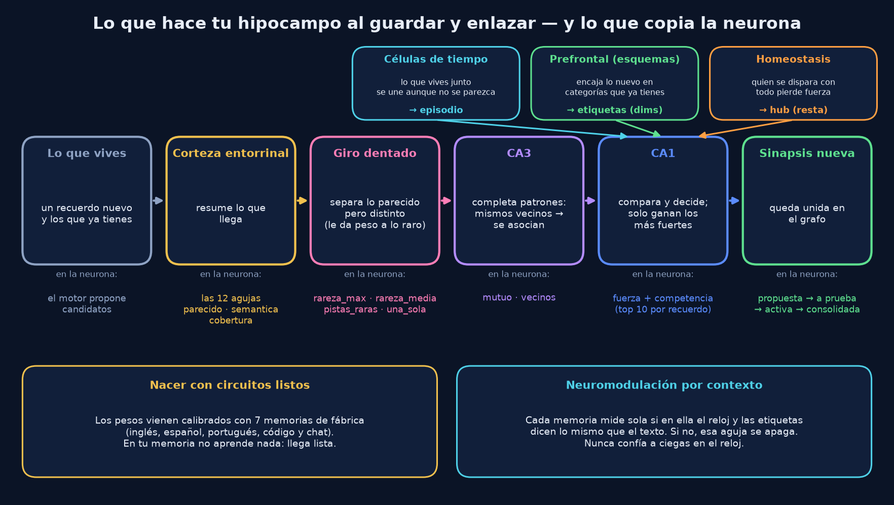

### 3. Un par real de tu memoria, paso a paso
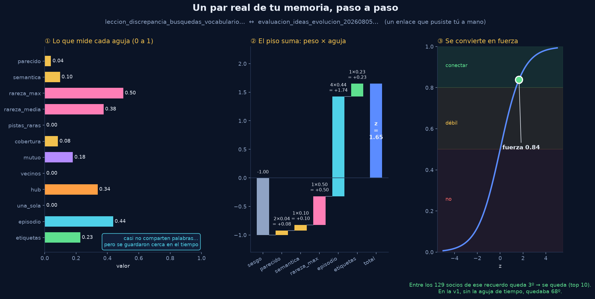

Uno de tus enlaces a mano. Casi no comparten palabras (parecido .04), pero comparten una pista rara
(.50) y se guardaron cerca en el tiempo (.44 ya pasado por la llave). El piso suma
−1 + 0.08 + 0.10 + 0.50 + 1.74 + 0.23 = **1.65**, y eso da fuerza **.84**: queda 3º de 129.

### 4. El banco: qué separa cada aguja en cada memoria
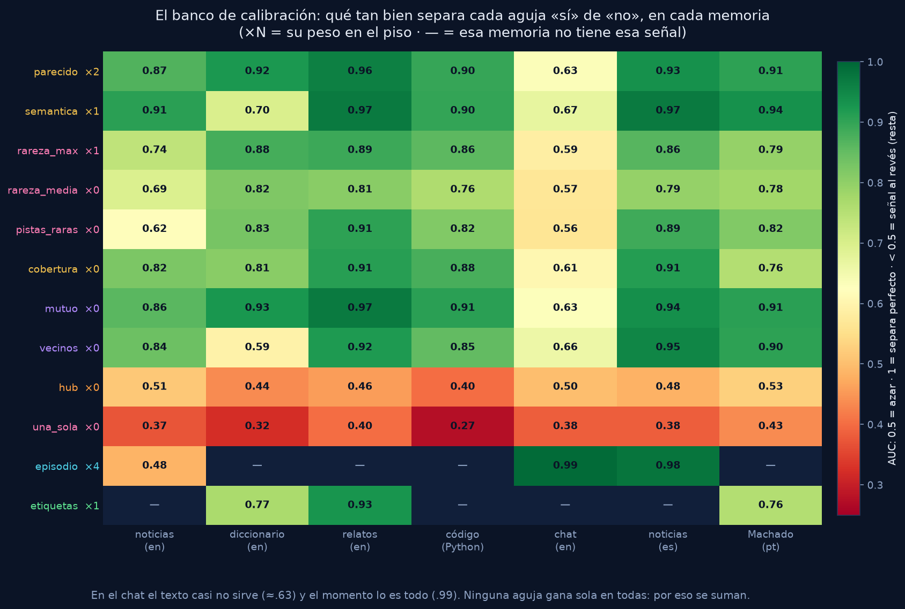

### 5. La huella en tu memoria
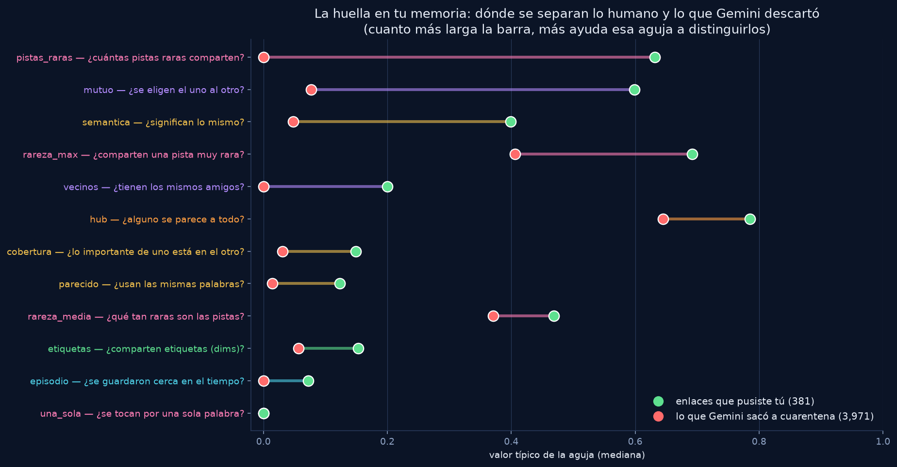

Para cada aguja, el valor típico de **tus** enlaces (verde) y el de lo que Gemini sacó a cuarentena
(rojo). Las que más separan son `pistas_raras`, `mutuo` y `semantica`. `hub` sale más alto en lo
humano; por eso el piso no lo usa para restar.

### 6. Las llaves de auto-regulación
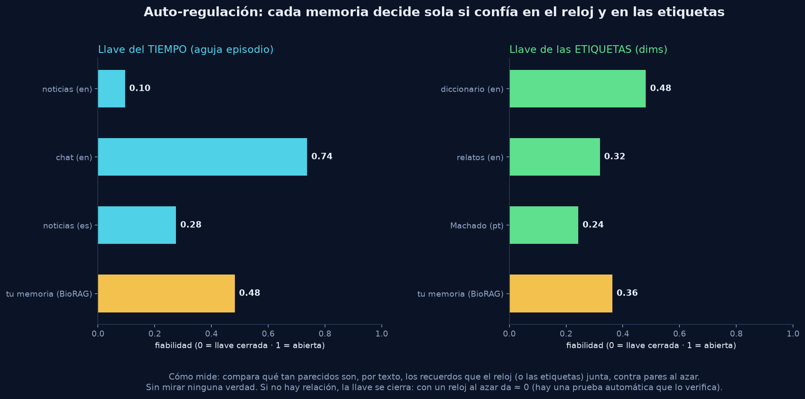

### 7. Examen «nunca vista»
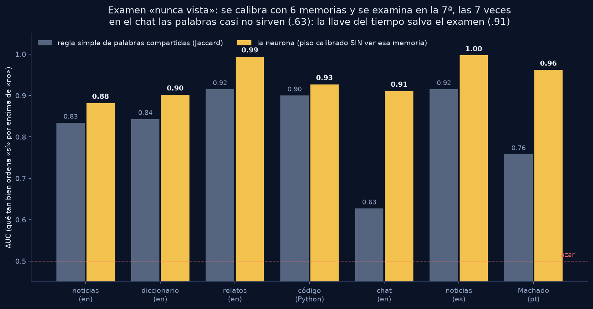

### 8. Tu memoria: tres jueces
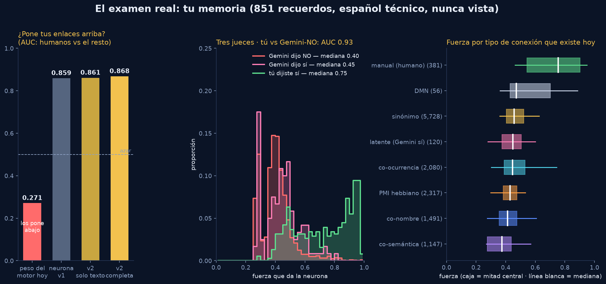

A la izquierda, el peso que usa el motor hoy pone tus enlaces **abajo** (.271); la neurona los pone
arriba (.868). En el medio, tus enlaces (verde) se van a fuerzas altas y lo que Gemini descartó (rojo)
se queda abajo. A la derecha, de todos los tipos de conexión que existen, los manuales son los más
fuertes por lejos.

### 9. Competencia
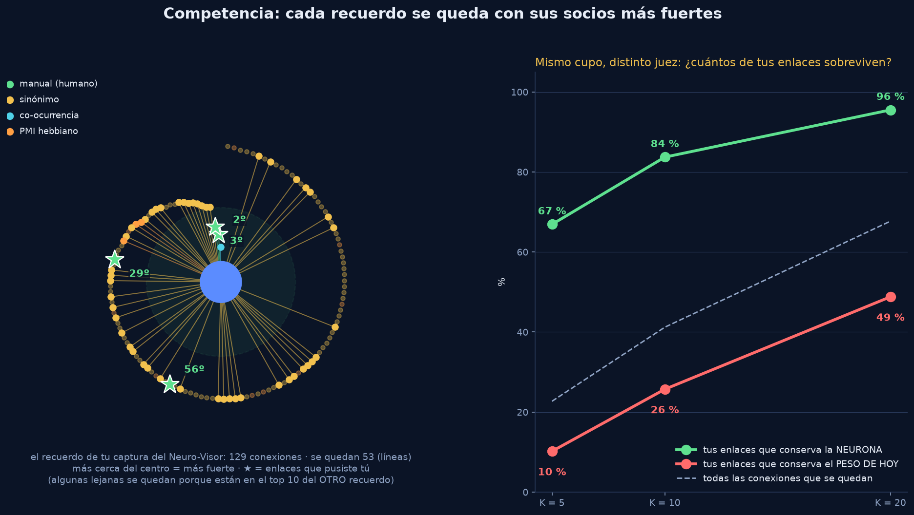

La espiral es el recuerdo de tu captura del Neuro-Visor: sus 129 conexiones, más cerca del centro =
más fuerte. Las ★ son tus 4 enlaces. A la derecha, con el mismo cupo de socios, la neurona conserva
muchos más de tus enlaces que el peso de hoy (84 % vs 26 % con K = 10).

### 10. Tu captura: puestos v1 → v2
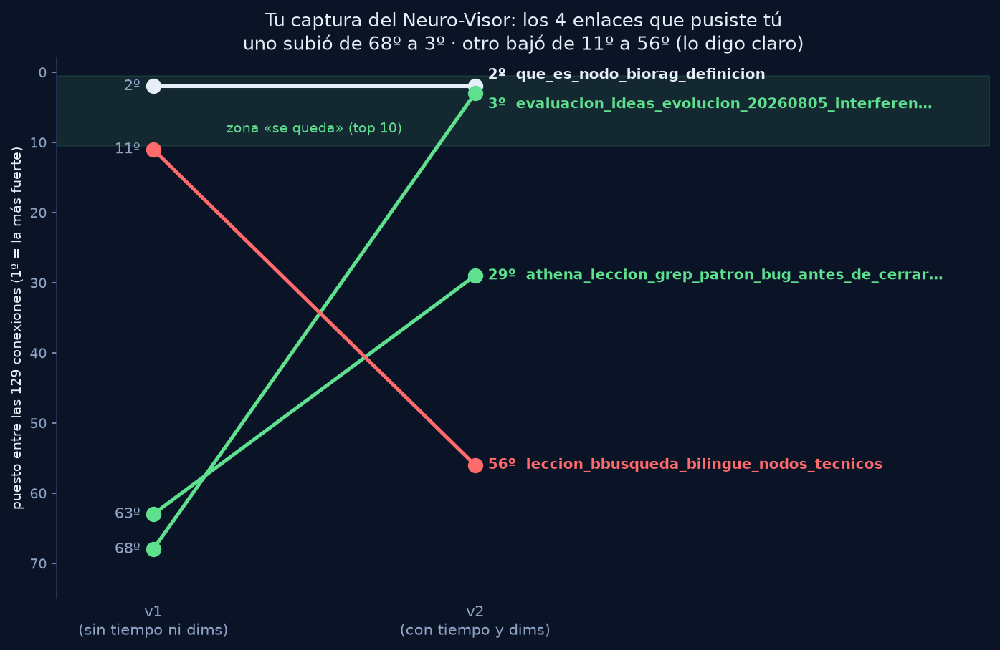

### 11. La balanza: por qué la parte que aprende queda apagada
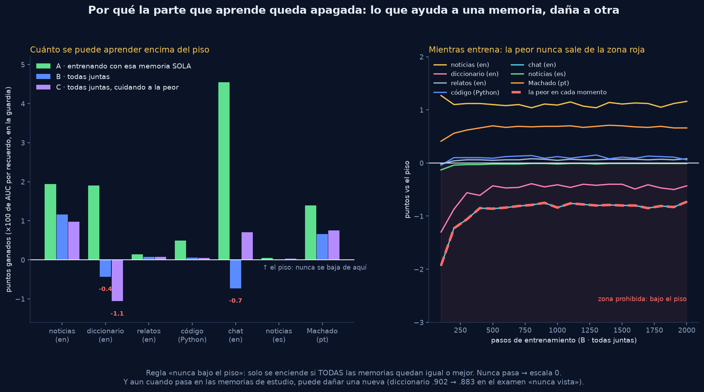

### 12. Lo que todavía le falta
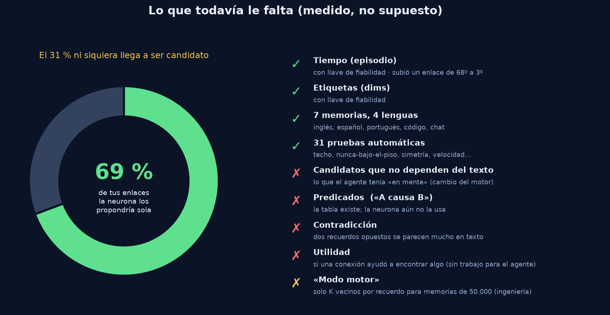


---

## V2.15. Decisiones de Dennys (2026-10-24)

1. **La neurona es cerrada: no aprende más.** Ni en fábrica ni dentro de la memoria de cada persona.
   En palabras de Dennys: la neurona *ya sabe* cómo hacer la sinapsis; tiene la fórmula. Coincide con
   los datos de la sección V2.6: una corrección aprendida dañó una memoria nueva. La maquinaria de
   entrenamiento queda solo como herramienta de laboratorio; `pesos_fabrica.json` sigue con escala 0.
   *Nota:* lo que sigue cambiando son las **sinapsis** del grafo (Hebb, sueño, desuso), como en el
   cerebro. La **regla** que decide si nace una sinapsis queda fija.
2. **Sí a la muestra marcada a mano.** La hoja de 100 pares está en `etiquetado/` (ver su `LEEME.md`).
   No se sube a git porque muestra trozos de recuerdos personales y el repo es público.
3. **`vincular_por_sinonimos`: arreglarlo antes de cablear.** Medido en la copia del snapshot:

   | Medida | Valor |
   |---|---|
   | Sinapsis `sinonimo_explicito` | **5,863** de 13,920 (42 %) |
   | Peso con el que nacen | .90 todas, sin mirar nada más |
   | Recuerdo con más sinapsis de este tipo | `version_actual_biorag`: **231** |
   | Mediana por recuerdo (de los 256 que tienen) / percentil 90 | 10 / 64 |
   | Fuerza mediana que les da la neurona | .456 (lo que Gemini descartó: .40; lo humano: .754) |

   La causa está en `core/sinapsis.py` (`vincular_por_sinonimos`): busca cada sinónimo como un
   **pedazo de texto** (`LIKE '%término%'`) dentro del nombre y los sinónimos de **todos** los
   recuerdos. No tiene tope. Así, un término corto o común une un recuerdo con decenas de otros.
   El arreglo va como cambio aislado, con QA antes y después, y no borra nada de lo que ya existe.

---

## V2.16. Para qué sirve la hoja, y qué pasó con `vincular_por_sinonimos`

### La hoja de 100 pares: para qué es

La neurona es cerrada: **tus respuestas no la cambian**. Usarlas para mover sus pesos sería
entrenarla con tu memoria, y eso quedó prohibido. La hoja es un **examen**, no una clase. Sirve para
cuatro decisiones:

| Grupo | Pregunta que responde | Qué hacemos con la respuesta |
|---|---|---|
| A · lo que la neurona conserva | ¿Lo que se queda es bueno? | Da la **precisión real**, el número para un auditor |
| B · lo que soltaría | ¿Perderías algo bueno? | Decide el **cupo K** (10 o 20 socios). Si en B hay muchos "sí", K sube |
| C · desacuerdos con Gemini | ¿Quién tenía razón? | Decide si la neurona puede **reemplazar a la hormiguita** |
| D · conexiones nuevas | ¿Vale la pena que proponga? | Decide si se enciende "la neurona propone" o solo juzga lo que el motor trae |

Y si marcas muchos `contradicen`, eso dice que hace falta la capa de contradicción.

### `vincular_por_sinonimos`: lo medí y cambié de opinión

`medir_sinonimos.py` simula, sobre la copia de tu memoria, qué sinapsis crearía cada regla con los
sinónimos de cada recuerdo (`resultados/sinonimos.json`):

| Regla | Pares | Máx. por recuerdo | Fuerza mediana | Enlaces humanos que encuentra |
|---|---|---|---|---|
| Hoy (pedazo de texto, sin tope) | 34,335 | 525 | .431 | 220 / 381 |
| Palabra completa | 19,335 | 276 | .440 | 183 / 381 |
| Palabra completa + ignorar términos en más de 10 recuerdos | 3,873 | 48 | .521 | 138 / 381 |
| … + tope de 10 por guardado | 2,896 | 22 | .536 | 122 / 381 |
| **Hoy + la neurona decide (top 5)** | 3,059 | 24 | **.711** | **148 / 381** |
| **Hoy + la neurona decide (top 10)** | 5,979 | 62 | .601 | **172 / 381** |
| Hoy + la neurona decide (top 20) | 11,614 | 156 | .528 | 196 / 381 |

Lectura simple:
- El problema **no** es tanto el "pedazo de texto". Son los **términos de tema** (`biorag` toca
  226 recuerdos, `athena` 104, `leccion` 94, `dennys` 92). No son sinónimos: son temas.
- Arreglarlo **a mano** (palabra completa, ignorar temas, tope) quita ruido, pero **pierde enlaces
  buenos**: de 220 humanos encontrados baja a 122. Eso rompe la regla "nunca bajar el recall".
- Con **el mismo volumen** (~3,000 pares), **la neurona encuentra más enlaces humanos que el arreglo
  a mano** (148 contra 122), y con mucha más fuerza (.71 contra .54).

**Conclusión:** el arreglo de `vincular_por_sinonimos` **es la neurona**. Un arreglo a mano antes
de cablear sería peor y habría que deshacerlo después. El plan pasa a ser:
1. Cablear la neurona en una copia, empezando por los dos puntos donde más sinapsis nacen al guardar
   (`vincular_por_sinonimos` y `auto_vincular`). Ella decide el **peso** con que nace cada sinapsis.
   Primero sin cortar nada.
2. QA antes y después. El "antes" ya está medido: `resultados/qa_base_antes_de_cablear.txt`
   (copia del snapshot, `PYTHONHASHSEED=1`): **R@5 100 %, R@1 91.89 %, MRR .950, 0 % falsos
   positivos, gate OK**.
3. Medir también la calidad del grafo, no solo el QA (el peso de las sinapsis casi no pesa en el
   ranking del QA).
4. Después, la neurona reemplaza a la hormiguita.

---

## V2.17. El examen de Dennys: 100 pares marcados a mano

Dennys marcó 99 de los 100 pares sin saber qué opinaba la neurona ni de dónde salía cada par.
Contestó 47 sí (45 sí + 2 "mismo momento"), 39 no y 13 no sé. Los "no sé" no cuentan.
Lo reproduce `etiquetado/analizar_hoja.py`, que guarda `resultados/examen_hoja_dennys.json`
(sin textos de recuerdos). La neurona **no aprendió nada** de estas respuestas: sigue cerrada.

| Grupo | Sí | No | No sé | % sí | Lectura |
|---|---|---|---|---|---|
| A · la neurona conserva | 21 | 15 | 3 | **58 %** | Precisión real más baja que en el laboratorio |
| B · la neurona soltaría | 8 | 14 | 8 | **36 %** | Más de un tercio de lo que soltaría es bueno |
| C · Gemini las sacó, la neurona las quería | 6 | 7 | 2 | 46 % | **Empate** con Gemini |
| D · la neurona propone (no existen hoy) | 12 | 3 | 0 | **80 %** | Lo mejor del examen |

**¿La fuerza separa lo bueno de lo malo?** Sí, de forma moderada: AUC **0.73** (margen 0.62–0.83).

| Fuerza | Sí |
|---|---|
| menos de 0.6 | 16 de 44 (36 %) |
| 0.6 o más | 31 de 42 (**74 %**) |

**En las sinapsis que ya existen** (58 pares con sí/no): neurona AUC **0.77** contra **0.63** del
peso de hoy. La neurona gana en el 93 % de los remuestreos, pero el margen de la diferencia
(−0.04 a 0.33) todavía cruza el cero. Con 58 pares es una señal fuerte, no una prueba firme.

### Qué decide este examen

1. **Cablear la neurona para que ponga el PESO de cada sinapsis: sí.** Ordena mejor que el peso de hoy.
2. **Que la neurona CORTE sinapsis (cupo K): no, por ahora.** El grupo B dice que perderíamos
   buenas conexiones. Primero solo pone el peso; no borra nada. Eso respeta "nunca bajar el recall".
3. **Reemplazar a la hormiguita: todavía no.** En los desacuerdos quedaron 6 a 7, con solo 13 pares.
   Gemini se queda hasta que haya más evidencia.
4. **Que la neurona proponga conexiones nuevas: sí, con cuidado.** 12 de 15 fueron buenas
   (son pocos pares).
5. **Capa de contradicción: no hace falta ahora.** Cero pares marcados como "se contradicen".

**Dato extra, honesto:** juntando A y B según su tamaño real, cerca de la **mitad de las sinapsis que
existen hoy no le parecen relacionadas a Dennys**. El grafo tiene mucho ruido, y por eso importa que
la neurona ponga el peso.

**Lo que este examen no puede decir:** son 100 pares. Los porcentajes tienen margen de error ancho.
Sirve para tomar decisiones de diseño, no para anunciar un número final.
