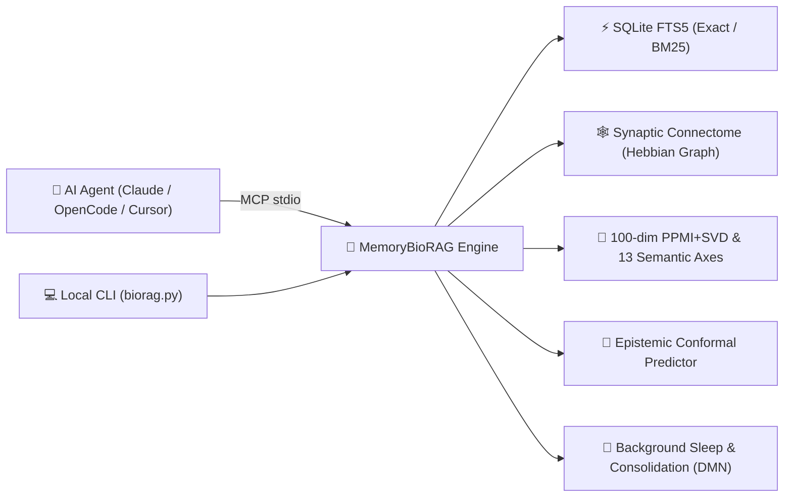

# MemoryBioRAG Stable

[](https://github.com/dennysjmarquez/MemoryBioRAG-Stable/releases)
[](LICENSE)
[](https://python.org)
[](https://modelcontextprotocol.io)
[](https://github.com/dennysjmarquez/MemoryBioRAG-Stable)

**Local-first, bio-inspired associative memory engine for AI agents.**

MemoryBioRAG is a persistent memory engine that provides AI agents with durable episodic context, evolving associative knowledge graphs, and cross-session continuity—without hosted vector databases, without cloud embeddings APIs, and running 100% locally on CPU.

Rather than treating memory as flat text buffers or rigid vector lookups, BioRAG mirrors biological neocortical dynamics: memories form synaptic associations through co-activation, consolidate during background rest cycles, and enforce mathematical epistemic certainty.

Interact with BioRAG through:
* **Model Context Protocol (MCP):** Connect any MCP-compatible agent (Claude Code, OpenCode, Cursor, Cline, Windsurf, or custom agent harnesses).
* **Local CLI (`biorag.py`):** Inspect, query, link, and awaken memories directly from your terminal.
* **Autonomous Daemons:** Background consolidation and Default Mode Network (DMN) reflection.



## Feature Overview

| Capability | Description |
|---|---|
| **Associative Connectome** | Memories link to each other via Hebbian synaptic weights that strengthen through activation (LTP) and decay over time (LTD). |
| **Epistemic Conformal Certainty** | Mathematical split conformal prediction establishes dynamic false-positive boundaries—preventing hallucinations and distinguishing direct facts from low-confidence associations. |
| **Local Multi-Signal Retrieval** | Multi-channel retrieval combining SQLite FTS5 BM25, 100-dim corpus-derived PPMI+SVD latent space, and 13 topological semantic dimensions. Zero GPUs or external API calls required. |
| **Autonomous Sleep Cycle & DMN** | Background daemons consolidate working memory into long-term structures, prune spurious connections, and detect cognitive gaps during idle periods. |
| **Fail-Fast Concept Hubs** | Multi-angle semantic bridge expansion resolving the "lexical abyss" problem where queries share zero literal tokens with stored knowledge. |
| **Zero-Touch Local Storage** | Pure local SQLite database at `~/.biorag/memory_biorag.db` (multiplatform). Zero telemetry, no external accounts, zero cloud lock-in. |
| **Universal MCP Interoperability** | Standard input/output (`stdio`) Model Context Protocol server compatible with Claude Code, OpenCode, Cursor, Cline, and any modern agent framework. |

---

## Quick start

### Requirements

- Python 3.11 or 3.12
- SQLite built with FTS5 support (standard in official Python distributions)
- Git (or download source ZIP directly from GitHub Releases)

### Clone and install

```bash
git clone https://github.com/dennysjmarquez/MemoryBioRAG-Stable.git
cd MemoryBioRAG-Stable
python3 -m venv .venv
```

Activate the virtual environment and run the automated installer:

**Linux or macOS**

```bash
. .venv/bin/activate
python -m pip install --upgrade pip
python -m pip install -r requirements.txt
python install.py
```

**Windows PowerShell**

```powershell
.\.venv\Scripts\Activate.ps1
python -m pip install --upgrade pip
python -m pip install -r requirements.txt
python install.py
```

The installer verifies environment prerequisites, configures detected MCP clients (OpenCode, Claude Desktop, Cursor, Claude Code, Cline, etc.), and sets up canonical storage at `~/.biorag/`.

After installation, inspect your configuration with:

```bash
python install.py --status
python biorag.py help
```

To display configuration snippets for manual client setup, run `python install.py --show-config`.

---

## Connect an MCP client

BioRAG communicates with agents via the standard input/output (`stdio`) transport. The automated installer detects and patches client configuration files automatically.

### Supported Clients

* **Claude Code / Claude Desktop:** Configured via `claude_desktop_config.json` or `.claude/`
* **OpenCode:** Native MCP configuration + bundled reminder plugin
* **Cursor / VS Code:** Configured in `settings.json` / `cursor.mcp.json`
* **Cline / Windsurf / Custom Agents:** Standard `stdio` server entry point: `python path/to/mcp_server.py`

### Exposed MCP Tools

| Tool | Purpose |
|---|---|
| `recordar` | High-level recall with epistemic certainty classification and paraphrase expansion. |
| `buscar` | Multi-signal semantic search across active and dormant memories. |
| `aprender` | Durable memory ingestion with pre-flight search verification. |
| `vincular` | Explicit Hebbian synaptic association between two conceptual nodes. |
| `estado` | Health status, node count, and synaptic density diagnostics. |

---

## Command-line interface

BioRAG includes a full-featured CLI (`biorag.py`) for direct inspection and management from your terminal.

```bash
# Search memory across all active nodes
python biorag.py buscar "project decision" --todos

# Search including dormant memories (deep search)
python biorag.py buscar "architecture refactoring" --deep

# Store a durable memory with conceptual keywords
python biorag.py guardar release_policy "Stable releases require verified test gates." --sustantivos-clave "stable,release,policy"

# Create a synaptic link between two concepts
python biorag.py asociar release_policy versioning_policy --tipo asociativa

# Inspect cortex health and statistics
python biorag.py estado

# Trigger a background consolidation cycle
python biorag.py sueno
```

Run `python biorag.py help` for the complete command reference.

---

## Bundled agent skill

The distribution bundles the `biorag-memory` skill at `skills/biorag-memory/SKILL.md`. The installer automatically deploys it to supported agent skill directories:
* `~/.claude/skills/biorag-memory/SKILL.md`
* `~/.config/opencode/skills/biorag-memory/SKILL.md`
* `~/.agents/skills/biorag-memory/SKILL.md`

---

## Data, configuration, and privacy

- **Default Storage:** SQLite database stored outside the repository at `~/.biorag/memory_biorag.db` (`%USERPROFILE%\.biorag\` on Windows).
- **Custom Location:** Set `BIORAG_PATH` to override the database path.
- **Privacy:** Core retrieval and storage are 100% local. BioRAG does not upload your database, memory contents, or telemetry.
- **Update Checker:** Checks public GitHub release tags every 24 hours (non-blocking). Disable anytime with `BIORAG_UPDATE_CHECK=0`.
- **Optional External Maintenance:** Background DMN reflection can optionally use Gemini API keys if explicitly configured; core search never requires external APIs.

---

## Repository Structure & Channels

* **Production / Distribution (`MemoryBioRAG-Stable`):** Official stable release channel. Contains clean, production-ready code, automated installer, and packaging metadata.
* **Research / Development (`MemoryBioRAG`):** Active research laboratory, historical benchmarks (921 QA suite), experimental scripts, and architectural exploration.

---

## License

Apache License 2.0. See [`LICENSE`](LICENSE).
